# Awesome Codex PPT Skills

[English](README.md)

让 **Codex、Claude Code 等编程 agent 做 PPT** 的开源 skill 和工具:可编辑 PPTX、图片式 PPT、网页幻灯片、咨询风、文档转 PPT。共 254 个仓库,每个都由 [Agent Skills Hub (agentskillshub.top)](https://agentskillshub.top) 读过 README 并做了安全评级。

带类型筛选的在线页面:**[https://agentskillshub.top/best/ppt-presentation/](https://agentskillshub.top/best/ppt-presentation/)** · 每 8 小时刷新

## 到底装哪个

我们实跑了其中 32 个(28 个出了结果),结论如下。[完整实测结果](#tested)在下面。

- 🥇 **要一份同事能接着改的 PowerPoint: [ppt-master](https://github.com/hugohe3/ppt-master)**  
  原生、结构化的 PPTX（可编辑性 L3），小修即可交付，内容检查单 100%；用时 11 分钟。想 3 分钟出一份、结构简单些，选 claude-office-skills（L2，100%）。Anthropic 官方的 pptx skill 2.4 分钟做出一份（L2，96%）。
- 🥈 **自己在浏览器里上台讲: [guizang-ppt-skill](https://github.com/op7418/guizang-ppt-skill)**  
  网页幻灯片，带原生表格和动画（L5），小修即可，内容 100%。要改得改代码，不是在 PowerPoint 里改。
- 🥉 **要视觉冲击: [rw-consulting-ppt](https://github.com/Pikapika260214/rw-consulting-ppt)**  
  图片优先的幻灯片，内容 100%，但每页都是一张图（L0），改一个字就要返工一轮。实测里 image-to-editable-ppt-skill 能把这种 deck 转回可编辑文字。

**之后还要改字的话别选:** gpt-image2-ppt-skills (整页图片，要大改); codex-ppt-skill (整页图片，要大改).

内容不是拉开差距的地方：27 份里 10 份检查单满分。按"之后能不能改"来选。

*排名规则：先看交付前要返工多少，再看可编辑性等级（PEI），最后看内容检查单。*

## 这些工具能做出什么

<table>
<tr>
<td align="center" valign="top" width="33%"><b>🧱 综合工具与框架</b> 27 个仓库  <a href="https://github.com/StarryKit/starry-slides">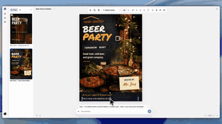</a> 能出多种幻灯片的大工具和多 agent 系统。 <a href="#type-general"><b>查看列表 →</b></a></td>
<td align="center" valign="top" width="33%"><b>📝 可编辑 PPTX</b> 97 个仓库   输出真正的 .pptx,能在 PowerPoint 里修改。 <a href="#type-pptx"><b>查看列表 →</b></a></td>
<td align="center" valign="top" width="33%"><b>🖼 图片式 PPT</b> 7 个仓库   每页是一张 AI 生成的图,好看但文字不能改。 <a href="#type-image"><b>查看列表 →</b></a></td>
</tr>
<tr>
<td align="center" valign="top" width="33%"><b>🌐 网页幻灯片</b> 73 个仓库  <a href="https://github.com/lewislulu/html-ppt-skill">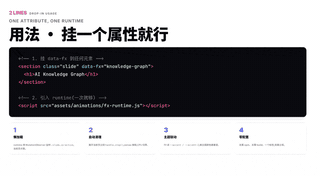</a> 网页形式的幻灯片:reveal.js、Slidev、杂志风翻页。 <a href="#type-html"><b>查看列表 →</b></a></td>
<td align="center" valign="top" width="33%"><b>💼 商务与咨询风</b> 17 个仓库  <a href="https://github.com/kgraph57/mckinsey-style-visualization-skill">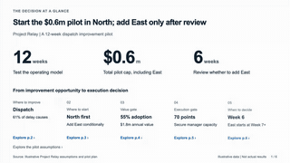</a> 咨询风、融资路演和工作汇报。 <a href="#type-business"><b>查看列表 →</b></a></td>
<td align="center" valign="top" width="33%"><b>📄 文档转 PPT</b> 33 个仓库  <a href="https://github.com/M1n-n9/academic-ppt-master">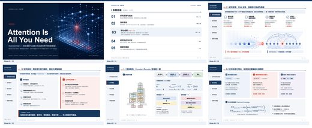</a> 把论文、PDF、文章、Markdown 转成幻灯片。 <a href="#type-convert"><b>查看列表 →</b></a></td>
</tr>
</table>

## 目录

- [🧪 端到端实测](#tested)
- [🧱 综合工具与框架](#type-general) (27)
- [📝 可编辑 PPTX](#type-pptx) (97)
- [🖼 图片式 PPT](#type-image) (7)
- [🌐 网页幻灯片](#type-html) (73)
- [💼 商务与咨询风](#type-business) (17)
- [📄 文档转 PPT](#type-convert) (33)

## 什么样的仓库能上榜

1. 它做幻灯片或演示文稿(PPT、PPTX、Keynote、网页幻灯片)。文档、海报生成器不算。
2. 它是给 agent 用的:skill、插件、MCP 服务器,或为 agent 写的工具包。
3. 它有 README。没有 README 就没法评级。
4. 50 星及以上只看是否切题;50 星以下还要过 README 质量线(展示成品、一条命令上手、说清产出、文档完整),并且至少 5 星。

这些问题由决策模型逐个读 README 回答,不是人工挑选。卡在线上的仓库可能判到任一边,归错了请提 issue。

## 🧪 端到端实测

2026-10-07 我们实跑了其中 32 个,跑成 28 个:每个在用完即删的沙箱里按同一份测试题做 deck,由 Claude Code (Claude Opus 5.5) 调用。按 PresentBench 的是/否检查单打分([arXiv 2603.07244](https://arxiv.org/abs/2603.07244),gpt-6-astra 核对),可编辑性按 SlidesGen-Bench 的 PEI 分级([arXiv 2601.09487](https://arxiv.org/abs/2601.09487),解析文件得出)。先按交付前返工程度,再按可编辑性,最后按内容检查单排序。

*每份 deck 的同一页："205 个 PPT skill、三条路线"，26 份用的是同一组数字。顺序同下表；每张下面是返工程度、可编辑性等级和内容检查单得分。*

*每份 deck 的封面页，顺序相同。*

| # | Skill | ★ | 交付前 | 可编辑性(PEI) | 内容检查单 | 分钟 | |
|---|---|---|---|---|---|---|---|
| 1 | [guizang-ppt-skill](https://github.com/op7418/guizang-ppt-skill) | 27,277 | 小修 | L5 + 动画 | 100% | 10.3 | [证据](https://agentskillshub.top/best-runs/ppt/op7418__guizang-ppt-skill.jpg) |
| 2 | [ppt-master](https://github.com/hugohe3/ppt-master) | 57,780 | 小修 | L3 + 结构化 | 100% | 11.0 | [证据](https://agentskillshub.top/best-runs/ppt/hugohe3__ppt-master.jpg) |
| 3 | [frontend-slides-editable](https://github.com/archlizheng/frontend-slides-editable) | 527 | 小修 | L3 + 结构化 | 100% | 4.3 | [证据](https://agentskillshub.top/best-runs/ppt/archlizheng__frontend-slides-editable.jpg) |
| 4 | [magic-slide](https://github.com/daniel-style/magic-slide) | 172 | 小修 | L3 + 结构化 | 96% | 5.1 | [证据](https://agentskillshub.top/best-runs/ppt/daniel-style__magic-slide.jpg) |
| 5 | [GordenPPTSkill](https://github.com/GordenSun/GordenPPTSkill) | 3,183 | 小修 | L3 + 结构化 | 89% | 3.5 | [证据](https://agentskillshub.top/best-runs/ppt/GordenSun__GordenPPTSkill.jpg) |
| 6 | [claude-office-skills](https://github.com/tfriedel/claude-office-skills) | 834 | 小修 | L2 + 矢量图形 | 100% | 3.2 | [证据](https://agentskillshub.top/best-runs/ppt/tfriedel__claude-office-skills.jpg) |
| 7 | [PPTAgent](https://github.com/icip-cas/PPTAgent) | 5,089 | 小修 | L2 + 矢量图形 | 100% | 4.6 | [证据](https://agentskillshub.top/best-runs/ppt/icip-cas__PPTAgent.jpg) |
| 8 | [ppt-agent-skills](https://github.com/sunbigfly/ppt-agent-skills) | 904 | 小修 | L2 + 矢量图形 | 96% | 16.2 | [证据](https://agentskillshub.top/best-runs/ppt/sunbigfly__ppt-agent-skills.jpg) |
| 9 | [skills](https://github.com/anthropics/skills) | 184,498 | 小修 | L2 + 矢量图形 | 96% | 2.4 | [证据](https://agentskillshub.top/best-runs/ppt/anthropics__skills.jpg) |
| 10 | [CyberPPT](https://github.com/crazyykhllc-bit/CyberPPT) | 1,760 | 小修 | L2 + 矢量图形 | 92% | 8.3 | [证据](https://agentskillshub.top/best-runs/ppt/crazyykhllc-bit__CyberPPT.jpg) |
| 11 | [frontend-slides](https://github.com/zarazhangrui/frontend-slides) | 30,187 | 小修 | L1 文字可改 | 100% | 6.2 | [证据](https://agentskillshub.top/best-runs/ppt/zarazhangrui__frontend-slides.jpg) |
| 12 | [GordenSuperPPTSkills](https://github.com/GordenSun/GordenSuperPPTSkills) | 2,044 | 小修 | L1 文字可改 | 97% | 14.0 | [证据](https://agentskillshub.top/best-runs/ppt/GordenSun__GordenSuperPPTSkills.jpg) |
| 13 | [revealjs-skill](https://github.com/ryanbbrown/revealjs-skill) | 413 | 小修 | L1 文字可改 | 93% | 4.9 | [证据](https://agentskillshub.top/best-runs/ppt/ryanbbrown__revealjs-skill.jpg) |
| 14 | [Office-PowerPoint-MCP-Server](https://github.com/GongRzhe/Office-PowerPoint-MCP-Server) | 1,855 | 小修 | L1 文字可改 | 93% | 6.7 | [证据](https://agentskillshub.top/best-runs/ppt/GongRzhe__Office-PowerPoint-MCP-Server.jpg) |
| 15 | [consulting-pptx-skill](https://github.com/gozen3ji/consulting-pptx-skill) | 1,113 | 小修 | L0 不可编辑 | 100% | 4.5 | [证据](https://agentskillshub.top/best-runs/ppt/gozen3ji__consulting-pptx-skill.jpg) |
| 16 | [marp-slides](https://github.com/robonuggets/marp-slides) | 320 | 小修 | L0 不可编辑 | 93% | 2.8 | [证据](https://agentskillshub.top/best-runs/ppt/robonuggets__marp-slides.jpg) |
| 17 | [dashi-ppt-skill](https://github.com/chuspeeism/dashi-ppt-skill) | 9,174 | 改一轮 | L3 + 结构化 | 94% | 14.3 | [证据](https://agentskillshub.top/best-runs/ppt/chuspeeism__dashi-ppt-skill.jpg) |
| 18 | [academic-pptx-skill](https://github.com/Gabberflast/academic-pptx-skill) | 1,114 | 改一轮 | L2 + 矢量图形 | 100% | 2.4 | [证据](https://agentskillshub.top/best-runs/ppt/Gabberflast__academic-pptx-skill.jpg) |
| 19 | [Mck-ppt-design-skill](https://github.com/likaku/Mck-ppt-design-skill) | 295 | 改一轮 | L2 + 矢量图形 | 97% | 2.6 | [证据](https://agentskillshub.top/best-runs/ppt/likaku__Mck-ppt-design-skill.jpg) |
| 20 | [mckinsey-pptx](https://github.com/seulee26/mckinsey-pptx) | 594 | 改一轮 | L2 + 矢量图形 | 93% | 1.9 | [证据](https://agentskillshub.top/best-runs/ppt/seulee26__mckinsey-pptx.jpg) |
| 21 | [handdrawn-ppt](https://github.com/moongiadventures-dev/handdrawn-ppt) | 8 | 改一轮 | L2 + 矢量图形 | 89% | 7.5 | [证据](https://agentskillshub.top/best-runs/ppt/moongiadventures-dev__handdrawn-ppt.jpg) |
| 22 | [html-ppt-skill](https://github.com/lewislulu/html-ppt-skill) | 8,588 | 改一轮 | L1 文字可改 | 96% | 3.9 | [证据](https://agentskillshub.top/best-runs/ppt/lewislulu__html-ppt-skill.jpg) |
| 23 | [rw-consulting-ppt](https://github.com/Pikapika260214/rw-consulting-ppt) | 467 | 改一轮 | L0 不可编辑 | 100% | 8.7 | [证据](https://agentskillshub.top/best-runs/ppt/Pikapika260214__rw-consulting-ppt.jpg) |
| 24 | [visual-style-ppt-skill](https://github.com/irenerachel/visual-style-ppt-skill) | 390 | 改一轮 | L0 不可编辑 | 100% | 8.1 | [证据](https://agentskillshub.top/best-runs/ppt/irenerachel__visual-style-ppt-skill.jpg) |
| 25 | [ppt-image-first](https://github.com/NyxTides/ppt-image-first) | 1,223 | 改一轮 | L0 不可编辑 | 96% | 8.1 | [证据](https://agentskillshub.top/best-runs/ppt/NyxTides__ppt-image-first.jpg) |
| 26 | [gpt-image2-ppt-skills](https://github.com/JuneYaooo/gpt-image2-ppt-skills) | 1,328 | 大改 | L0 不可编辑 | 96% | 9.6 | [证据](https://agentskillshub.top/best-runs/ppt/JuneYaooo__gpt-image2-ppt-skills.jpg) |
| 27 | [codex-ppt-skill](https://github.com/ningzimu/codex-ppt-skill) | 6,354 | 大改 | L0 不可编辑 | 93% | 4.5 | [证据](https://agentskillshub.top/best-runs/ppt/ningzimu__codex-ppt-skill.jpg) |
| 28 | [image-to-editable-ppt-skill](https://github.com/ningzimu/image-to-editable-ppt-skill) | 2,781 | 小修 | L2 + 矢量图形 | 96% | 10.1 | [证据](https://agentskillshub.top/best-runs/ppt/ningzimu__image-to-editable-ppt-skill.jpg) |

**未能实测:** NanoBanana-PPT-Skills (需要 Google Gemini 的图片 key，未测。); open-kimi-ppt-skill (仓库已被作者以版权为由清空，只剩一个 README。); codex-ppt (只能在 Codex 里用：要用 Codex 内置的画图工具。); MultiAgentPPT (是一个独立的 Web 应用，里面的 agent 需要自己的模型 API key，不是 Claude Code 的 skill。)

[全部结果、提示词和脚本](https://github.com/zhuyansen/agent-skills-hub/blob/main/ops/ppt-runs/RESULTS.md) · [https://agentskillshub.top/best/ppt-presentation/#test-results](https://agentskillshub.top/best/ppt-presentation/#test-results)

## 🧱 综合工具与框架

[在在线页面打开这一类,按星数排序 →](https://agentskillshub.top/best/ppt-presentation/#type-general)

<table><tr>
<td align="center" valign="top"> <a href="https://github.com/wuyoscar/GPT-Image2-Skill">wuyoscar/GPT-Image2-Skill</a></td>
<td align="center" valign="top"><a href="https://github.com/minorun365/minorun-marp-skill">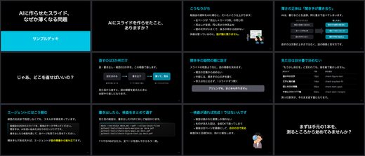</a> <a href="https://github.com/minorun365/minorun-marp-skill">minorun365/minorun-marp-skill</a></td>
<td align="center" valign="top"><a href="https://github.com/gnipbao/knowledge-cat-ppt-skill">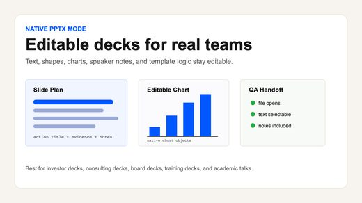</a> <a href="https://github.com/gnipbao/knowledge-cat-ppt-skill">gnipbao/knowledge-cat-ppt-skill</a></td>
</tr></table>

| 仓库 | 星数 | 做什么 | 安全评级 |
|---|---:|---|---|
| [wuyoscar/GPT-Image2-Skill](https://github.com/wuyoscar/GPT-Image2-Skill) | 6.1k | GPT Image 2/2.5 提示词画廊、图像提示词库、agentic skill 和 OpenAI 图像生成/编辑 CLI | [SAFE](https://agentskillshub.top/skill/wuyoscar/GPT-Image2-Skill/) |
| [tfriedel/claude-office-skills](https://github.com/tfriedel/claude-office-skills) | 849 | Claude Code 的办公文档创建与编辑技能，支持 PPTX、DOCX、XLSX 和 PDF 自动化流程 | [SAFE](https://agentskillshub.top/skill/tfriedel/claude-office-skills/) |
| [minhnv0807/ai-business-skills](https://github.com/minhnv0807/ai-business-skills) | 675 | 138个双语AI营销skill（69越南+69全球），适用于Claude Code、OpenCode、Codex、VS Code；含4类角色SOP及策略等。配… | [SAFE](https://agentskillshub.top/skill/minhnv0807/ai-business-skills/) |
| [mucsbr/ppt-agent-workflow-san](https://github.com/mucsbr/ppt-agent-workflow-san) | 652 | 渐进式交互式 PPT 生成 skill | [SAFE](https://agentskillshub.top/skill/mucsbr/ppt-agent-workflow-san/) |
| [minorun365/minorun-marp-skill](https://github.com/minorun365/minorun-marp-skill) | 418 | 用于用 Marp 制作演讲幻灯片的故事、图示、设计平衡技能集，以及黑色背景主题和检查工具 | [SAFE](https://agentskillshub.top/skill/minorun365/minorun-marp-skill/) |
| [rsrohan99/presenter](https://github.com/rsrohan99/presenter) | 187 | 多智能体 AI 工具，可创建带配音的演示文稿 | [SAFE](https://agentskillshub.top/skill/rsrohan99/presenter/) |
| [Sven-LI-sankyuu/presentation-skills](https://github.com/Sven-LI-sankyuu/presentation-skills) | 179 | Codex CLI 的演示工作流 skill 集合，涵盖可编辑 PPT 图示协作和网页 demo 视频合成。 | [SAFE](https://agentskillshub.top/skill/Sven-LI-sankyuu/presentation-skills/) |
| [StarryKit/starry-slides](https://github.com/StarryKit/starry-slides) | 102 | AI 幻灯片与演示文稿编辑器。Agent 幻灯片与演示文稿 skill。HTML 编辑器。 | [SAFE](https://agentskillshub.top/skill/StarryKit/starry-slides/) |
| [gnipbao/knowledge-cat-ppt-skill](https://github.com/gnipbao/knowledge-cat-ppt-skill) | 96 | 以故事为先的 Agent skill，用于创建、路由和质检 PPT、HTML 及图像优先的演示文稿 | [SAFE](https://agentskillshub.top/skill/gnipbao/knowledge-cat-ppt-skill/) |
| [SpaceZephyr/space-multi-design-ppt](https://github.com/SpaceZephyr/space-multi-design-ppt) | 83 | 适用于 Codex 的品牌设计系统幻灯片 skill | [SAFE](https://agentskillshub.top/skill/SpaceZephyr/space-multi-design-ppt/) |
| [appautomaton/presentation](https://github.com/appautomaton/presentation) | 66 | 输入业务问题，生成演示文稿。Claude Code 和 Codex 的四种可组合 skill：战略分镜、品牌识别、像素级 PDF、原生可编辑 PPTX。 | [SAFE](https://agentskillshub.top/skill/appautomaton/presentation/) |
| [touying-typ/seaslides](https://github.com/touying-typ/seaslides) | 52 | 使用 Typst 和 Touying 生成演示文稿的 AI skills | [SAFE](https://agentskillshub.top/skill/touying-typ/seaslides/) |
| [zhuyansen/awesome-codex-ppt-skills](https://github.com/zhuyansen/awesome-codex-ppt-skills) | 43 | 让 Codex、Claude Code 等编程 agent 制作幻灯片的开源 skill 和工具，按类型分类并标注安全等级。English / 中文 | [SAFE](https://agentskillshub.top/skill/zhuyansen/awesome-codex-ppt-skills/) |
| [wangzan101/html-to-ppt-pdf](https://github.com/wangzan101/html-to-ppt-pdf) | 40 | Agents skill：将 guizang-ppt-skill 横向翻页 HTML 演示文稿转为 PDF 和图片型 PPTX，供线下演讲 | [SAFE](https://agentskillshub.top/skill/wangzan101/html-to-ppt-pdf/) |
| [HeiGeAi/HeiGe-PPT](https://github.com/HeiGeAi/HeiGe-PPT) | 21 | 演讲锻造系统：把每页讲成一句话，将整套 deck 导成演出 | [SAFE](https://agentskillshub.top/skill/HeiGeAi/HeiGe-PPT/) |
| [prodigeproject/pradaslides](https://github.com/prodigeproject/pradaslides) | 16 | 基于能力、面向受众的演示 agent skill，支持 PPTX、HTML 幻灯片、PDF 和演示文稿规划。 | [SAFE](https://agentskillshub.top/skill/prodigeproject/pradaslides/) |
| [ConnorRX56/presentation-delivery-skills](https://github.com/ConnorRX56/presentation-delivery-skills) | 12 | 输入一句话，输出可编辑的 PPTX。逆向分析 Claude Design 和 Fable 的前端模式，用于视觉设计和人类意图 QA。 | [SAFE](https://agentskillshub.top/skill/ConnorRX56/presentation-delivery-skills/) |
| [ThunderOne18/ppt-expert-team](https://github.com/ThunderOne18/ppt-expert-team) | 11 | AI 做 PPT 是工作流问题：八步 Claude/Codex skill，将文章、口播稿转为可编辑 HTML PPT、图片版或 PPTX，含六种风格、风格选… | [SAFE](https://agentskillshub.top/skill/ThunderOne18/ppt-expert-team/) |
| [att6113/ppt-design-system](https://github.com/att6113/ppt-design-system) | 11 | 基于 guizang-ppt-skill 和 Open Design 的 PPT 设计系统：5 套主题、10 种布局，支持 HTML/PPTX 输出 | [SAFE](https://agentskillshub.top/skill/att6113/ppt-design-system/) |
| [studio-yebisu/yaoyorozu-ai-toolbox-slides](https://github.com/studio-yebisu/yaoyorozu-ai-toolbox-slides) | 11 | 八百万図AI工具箱：AI幻灯片。根据skill效果、输入、输出和日语示例选择资料制作工具。 | [SAFE](https://agentskillshub.top/skill/studio-yebisu/yaoyorozu-ai-toolbox-slides/) |
| [nugrahalabib/AgentBuff-Presentation-Skills](https://github.com/nugrahalabib/AgentBuff-Presentation-Skills) | 8 | 通用 skill：创建演示文稿并导出为 HTML、PDF、PNG/JPG 或 PPTX（像素级一致），支持 Claude Code、Codex、Hermes… | [SAFE](https://agentskillshub.top/skill/nugrahalabib/AgentBuff-Presentation-Skills/) |
| [xukp20/build-beamer-slides](https://github.com/xukp20/build-beamer-slides) | 8 | 用于设计、渲染和视觉审查 Beamer 幻灯片的 Codex skill。 | [SAFE](https://agentskillshub.top/skill/xukp20/build-beamer-slides/) |
| [taufiquebuilds/nopurple](https://github.com/taufiquebuilds/nopurple) | 7 | 由人设计而非 AI 生成的幻灯片和图表，适用于 Claude Code、Codex 和 Cursor 的 agent skills。 | [SAFE](https://agentskillshub.top/skill/taufiquebuilds/nopurple/) |
| [chunyifish/soil-teaching-slides](https://github.com/chunyifish/soil-teaching-slides) | 6 | SOIL 风格教学幻灯片 skill，适用于 PPTX、NotebookLM 和离线 HTML 演示文稿 | [SAFE](https://agentskillshub.top/skill/chunyifish/soil-teaching-slides/) |
| [dingjq1216/PPT-Knowledge-Skill](https://github.com/dingjq1216/PPT-Knowledge-Skill) | 5 | PPT-Knowledge-Skill：ppt-illustrator 用 python-pptx 生成可编辑 PPTX，含四角色流程。 | [SAFE](https://agentskillshub.top/skill/dingjq1216/PPT-Knowledge-Skill/) |
| [josezuma/yc-pitch-deck-max](https://github.com/josezuma/yc-pitch-deck-max) | 5 | The super-skill for startup pitch decks. Combines YC content frameworks, 30+ design styles, PPTX/HTML/Marp output, investor intelligence, and deck an… | [SAFE](https://agentskillshub.top/skill/josezuma/yc-pitch-deck-max/) |
| [kiselas/every-slide-is-code](https://github.com/kiselas/every-slide-is-code) | 5 | Claude Code、Codex 和 ChatGPT 的 Agent Skill：以单个 HTML 文件生成演示文稿，支持图表、图示、转场、演讲者视图及 P… | [SAFE](https://agentskillshub.top/skill/kiselas/every-slide-is-code/) |

## 📝 可编辑 PPTX

[在在线页面打开这一类,按星数排序 →](https://agentskillshub.top/best/ppt-presentation/#type-pptx)

<table><tr>
<td align="center" valign="top"><a href="https://github.com/ningzimu/image-to-editable-ppt-skill">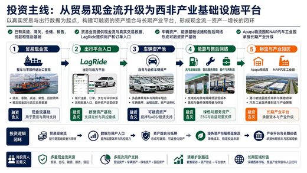</a> <a href="https://github.com/ningzimu/image-to-editable-ppt-skill">ningzimu/image-to-editable-ppt-skill</a></td>
<td align="center" valign="top"><a href="https://github.com/GongRzhe/Office-PowerPoint-MCP-Server">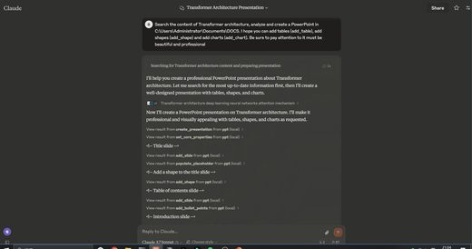</a> <a href="https://github.com/GongRzhe/Office-PowerPoint-MCP-Server">GongRzhe/Office-PowerPoint-MCP-Server</a></td>
<td align="center" valign="top"><a href="https://github.com/johnson7788/MultiAgentPPT">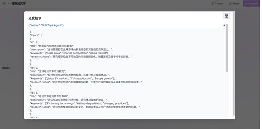</a> <a href="https://github.com/johnson7788/MultiAgentPPT">johnson7788/MultiAgentPPT</a></td>
</tr></table>

| 仓库 | 星数 | 做什么 | 安全评级 |
|---|---:|---|---|
| [icip-cas/PPTAgent](https://github.com/icip-cas/PPTAgent) | 5.2k | 用于反思式 PowerPoint 生成的智能体框架 | [SAFE](https://agentskillshub.top/skill/icip-cas/PPTAgent/) |
| [GordenSun/GordenPPTSkill](https://github.com/GordenSun/GordenPPTSkill) | 4.1k | AI PPT 构建 skill：17 个中文 PPTX 模板和非破坏性纯文本编辑工具（基于 python-pptx）。选择模板并编写 edits.json，生… | [SAFE](https://agentskillshub.top/skill/GordenSun/GordenPPTSkill/) |
| [ningzimu/image-to-editable-ppt-skill](https://github.com/ningzimu/image-to-editable-ppt-skill) | 3.3k | 用于将幻灯片图像、PDF 和基于图像的 PPTX 文件转换为可编辑 PowerPoint 演示文稿的 Codex skill。 | [SAFE](https://agentskillshub.top/skill/ningzimu/image-to-editable-ppt-skill/) |
| [GordenSun/GordenSuperPPTSkills](https://github.com/GordenSun/GordenSuperPPTSkills) | 2.3k | 使用GPT生成图片格式PPT，并转换为可编辑的PPTX文件。 | [SAFE](https://agentskillshub.top/skill/GordenSun/GordenSuperPPTSkills/) |
| [GongRzhe/Office-PowerPoint-MCP-Server](https://github.com/GongRzhe/Office-PowerPoint-MCP-Server) | 1.9k | 基于 python-pptx 的 MCP（Model Context Protocol）服务器，用于创建、编辑和操作 PowerPoint 演示文稿。 | [SAFE](https://agentskillshub.top/skill/GongRzhe/Office-PowerPoint-MCP-Server/) |
| [johnson7788/MultiAgentPPT](https://github.com/johnson7788/MultiAgentPPT) | 1.6k | MultiAgentPPT 是集成 A2A、MCP 和 ADK 架构的演示文稿生成系统，支持多智能体协作和流式并发。 | [SAFE](https://agentskillshub.top/skill/johnson7788/MultiAgentPPT/) |
| [JuneYaooo/gpt-image2-ppt-skills](https://github.com/JuneYaooo/gpt-image2-ppt-skills) | 1.5k | 将任意 .pptx 复刻为自己的演示文稿：OpenAI gpt-image-2 模仿版式，你提供内容。含 10 套风格。Claude Code / OpenC… | [SAFE](https://agentskillshub.top/skill/JuneYaooo/gpt-image2-ppt-skills/) |
| [sunbigfly/ppt-agent-skills](https://github.com/sunbigfly/ppt-agent-skills) | 924 | 代码驱动的演示文稿生成框架，像构建软件工程一样生成演示文稿。 | [SAFE](https://agentskillshub.top/skill/sunbigfly/ppt-agent-skills/) |
| [addsumtech/slides_maker](https://github.com/addsumtech/slides_maker) | 667 | 在 Codex / Claude Code 中，将论文、代码和文档转为可演示、原生可编辑的 PPTX，支持原生图表、公式、演讲者备注、点击构建动画，并经独立… | [SAFE](https://agentskillshub.top/skill/addsumtech/slides_maker/) |
| [sunchaokun/PPT-Design-Skill](https://github.com/sunchaokun/PPT-Design-Skill) | 505 | 面向 OpenCode/Claude Code/Codex 的 PPT 设计 skill，支持 Build Mode、AI 生图和可编辑 PPTX，涵盖需求分… | [SAFE](https://agentskillshub.top/skill/sunchaokun/PPT-Design-Skill/) |
| [AI272/speaker](https://github.com/AI272/speaker) | 479 | Speaker 是学术演示 Codex skill：读取 real.pptx，结合文本提取、PPTX解析、逐页渲染、OCR和视觉检查生成讲稿，并写入Power… | [SAFE](https://agentskillshub.top/skill/AI272/speaker/) |
| [zhouwei713/luobo-ppt](https://github.com/zhouwei713/luobo-ppt) | 475 | 生成和美化可编辑原生 PPT 的 Agent Skill | [SAFE](https://agentskillshub.top/skill/zhouwei713/luobo-ppt/) |
| [barun-saha/slide-deck-ai](https://github.com/barun-saha/slide-deck-ai) | 378 | 与 AI 协作制作 PowerPoint 幻灯片演示文稿 | [SAFE](https://agentskillshub.top/skill/barun-saha/slide-deck-ai/) |
| [zouchenzhen/thesis-defense-pptx-skill](https://github.com/zouchenzhen/thesis-defense-pptx-skill) | 281 | Codex / Claude skill：从论文 PDF 或 LaTeX 生成可编辑答辩 PPTX，保留 PowerPoint 模板风格 | [SAFE](https://agentskillshub.top/skill/zouchenzhen/thesis-defense-pptx-skill/) |
| [thePlannerIvan/planners-ppt-hell](https://github.com/thePlannerIvan/planners-ppt-hell) | 248 | 面向规划人员的 PPT skill。 | [SAFE](https://agentskillshub.top/skill/thePlannerIvan/planners-ppt-hell/) |
| [EveryInc/hands-on-deck](https://github.com/EveryInc/hands-on-deck) | 224 | 面向 agent 的 PowerPoint 操作工具：通过 CLI 和原子 JSON 补丁检查、编辑、创建并验证 .pptx 文件，以 Agent Skill… | [SAFE](https://agentskillshub.top/skill/EveryInc/hands-on-deck/) |
| [wwe-dog/ppt-image2-editable-rebuild](https://github.com/wwe-dog/ppt-image2-editable-rebuild) | 205 | 基于截图/参考图重建可编辑PPT的Codex skill：用image2/imagegen生成参考图，以局部截图保留视觉资产并重建可编辑元素。 | [SAFE](https://agentskillshub.top/skill/wwe-dog/ppt-image2-editable-rebuild/) |
| [w1163222589-coder/slide-image-to-editable-pptx](https://github.com/w1163222589-coder/slide-image-to-editable-pptx) | 198 | 将幻灯片截图转换为可编辑 PowerPoint 演示文稿的 Codex skill。 | [SAFE](https://agentskillshub.top/skill/w1163222589-coder/slide-image-to-editable-pptx/) |
| [Arinin77/image2editable-ppt](https://github.com/Arinin77/image2editable-ppt) | 185 | 一个 Codex skill，将图像、示意图和论文图表重建为元素级可编辑的 PowerPoint，附带注明来源的示例和视觉检查。 | [SAFE](https://agentskillshub.top/skill/Arinin77/image2editable-ppt/) |
| [Akxan/ppt-agent-skill](https://github.com/Akxan/ppt-agent-skill) | 182 | AI演示文稿生成器，支持26种风格和18种图表；Claude Code Skill将一句话生成HTML和可编辑PPTX演示文稿 | [SAFE](https://agentskillshub.top/skill/Akxan/ppt-agent-skill/) |
| [jinwyp/open-ppt-skill](https://github.com/jinwyp/open-ppt-skill) | 178 | Slides Skill：让 AI Agent 生成可编辑 PPTD、PPTX，并配备本地浏览器编辑器 | [SAFE](https://agentskillshub.top/skill/jinwyp/open-ppt-skill/) |
| [xdmlxdml/beamer2pptx](https://github.com/xdmlxdml/beamer2pptx) | 176 | 将 Beamer PDF 转换为含原生公式的可编辑 PowerPoint 演示文稿的 Codex Skill。 | [SAFE](https://agentskillshub.top/skill/xdmlxdml/beamer2pptx/) |
| [knight6669/knight-imagetopptx-skill](https://github.com/knight6669/knight-imagetopptx-skill) | 141 | 将语义幻灯片图像转换为可编辑 PPTX 的 Codex skill | [SAFE](https://agentskillshub.top/skill/knight6669/knight-imagetopptx-skill/) |
| [Noi1r/powerpoint-skill](https://github.com/Noi1r/powerpoint-skill) | 132 | 用于创建 PowerPoint (.pptx) 演示文稿的 AI coding assistant skill，支持原生 OMML、LaTeX 公式及 Gra… | [SAFE](https://agentskillshub.top/skill/Noi1r/powerpoint-skill/) |
| [Ayushmaniar/powerpoint-mcp](https://github.com/Ayushmaniar/powerpoint-mcp) | 128 | 用于 Windows 上 PowerPoint 自动化的开源 Model Context Protocol 服务器，基于 pywin32 | [SAFE](https://agentskillshub.top/skill/Ayushmaniar/powerpoint-mcp/) |
| [gnuhpc/ppt-master-plus](https://github.com/gnuhpc/ppt-master-plus) | 108 | PPT Master Plus skill：可编辑PPTX生成、美化、演讲者备注、实时预览和模板 | [SAFE](https://agentskillshub.top/skill/gnuhpc/ppt-master-plus/) |
| [siril9/presentation-skill](https://github.com/siril9/presentation-skill) | 105 | MIT许可的agent skill和Codex插件，用于内容驱动、可编辑的PowerPoint演示文稿。基于JSON重建；支持原生图表、表格和渲染视觉质检。 | [SAFE](https://agentskillshub.top/skill/siril9/presentation-skill/) |
| [henryhyw/slidepoise](https://github.com/henryhyw/slidepoise) | 101 | 开源的智能体幻灯片生成工具，支持自由形式视觉设计和可编辑的 PowerPoint 输出。 | [SAFE](https://agentskillshub.top/skill/henryhyw/slidepoise/) |
| [Hasasasa/html-to-editable-pptx](https://github.com/Hasasasa/html-to-editable-pptx) | 98 | 将 HTML 幻灯片转换为可编辑 PPT/.pptx，文本保留为 PowerPoint 原生文本框。支持 Agent skill（Claude Code、Cu… | [SAFE](https://agentskillshub.top/skill/Hasasasa/html-to-editable-pptx/) |
| [ACTAshui/sjtu-ppt-template-skill](https://github.com/ACTAshui/sjtu-ppt-template-skill) | 84 | 用于创建可编辑的上海交通大学风格 PowerPoint 演示文稿的 Codex skill | [SAFE](https://agentskillshub.top/skill/ACTAshui/sjtu-ppt-template-skill/) |
| [wiltonesten-web/codeximage-to-editable-ppt-v2-1](https://github.com/wiltonesten-web/codeximage-to-editable-ppt-v2-1) | 81 | 高级 Codex skill：将图像PPT/PPTX忠实还原为可编辑演示文稿，支持语义分层、可编辑文本、原生形状、裁剪与背景审查、渲染质检及交付验证 | [CAUTION](https://agentskillshub.top/skill/wiltonesten-web/codeximage-to-editable-ppt-v2-1/) |
| [NeekChaw/mcp-server-okppt](https://github.com/NeekChaw/mcp-server-okppt) | 68 | MCP OKPPT Server 基于 MCP，让 Claude、GPT 通过 SVG 创建 PowerPoint 并保留矢量特性 | [SAFE](https://agentskillshub.top/skill/NeekChaw/mcp-server-okppt/) |
| [DSY-Xueai/image2editable](https://github.com/DSY-Xueai/image2editable) | 63 | 用于 Codex 和 Claude Code 的 skill 工具，将图像、PDF 和图像型 PPTX 转为可编辑的 PowerPoint 演示文稿。 | [SAFE](https://agentskillshub.top/skill/DSY-Xueai/image2editable/) |
| [AIPMAndy/PPTskill](https://github.com/AIPMAndy/PPTskill) | 58 | AI 生成原生可编辑 PPTX | [CAUTION](https://agentskillshub.top/skill/AIPMAndy/PPTskill/) |
| [qybaihe/codex-ppt](https://github.com/qybaihe/codex-ppt) | 56 | Codex PPT 是用于制作16:9演示文稿的 Codex skill，支持图片模式和可编辑PPTX模式：先生成幻灯片图片，再重建为可编辑文字和可移动图层。 | [SAFE](https://agentskillshub.top/skill/qybaihe/codex-ppt/) |
| [wiltonesten-web/codeximage-to-editable-ppt-v1](https://github.com/wiltonesten-web/codeximage-to-editable-ppt-v1) | 54 | 用于将图片型 PPT/PPTX 幻灯片重建为可编辑 PowerPoint 文稿的 Codex skill | [CAUTION](https://agentskillshub.top/skill/wiltonesten-web/codeximage-to-editable-ppt-v1/) |
| [huashu996/PPT-Framework-Skill](https://github.com/huashu996/PPT-Framework-Skill) | 53 | 面向 Codex 的可编辑学术框图 PowerPoint skill，支持参考图复刻、内容生成技术路线图和系统框图，输出可编辑原生对象及公式。 | [SAFE](https://agentskillshub.top/skill/huashu996/PPT-Framework-Skill/) |
| [TianLin0509/img2ppt-lite](https://github.com/TianLin0509/img2ppt-lite) | 49 | 将幻灯片示意图转为可编辑PPTX：原生文本、可拖动语义精灵和修复背景，适用于Claude Code、Codex及任意CLI agent的Agent-as-VL… | [SAFE](https://agentskillshub.top/skill/TianLin0509/img2ppt-lite/) |
| [opitaru-sys/deck-dna](https://github.com/opitaru-sys/deck-dna) | 49 | 一个 Claude skill，制作匹配真实设计师演示文稿的 PPTX：提取设计 DNA、测算文字量、渲染质检闭环。 | [SAFE](https://agentskillshub.top/skill/opitaru-sys/deck-dna/) |
| [riteouschris-max/journal-club-ppt](https://github.com/riteouschris-max/journal-club-ppt) | 48 | 可复用 skill：根据研究论文制作清晰、基于证据的文献研讨会演示文稿。 | [SAFE](https://agentskillshub.top/skill/riteouschris-max/journal-club-ppt/) |
| [CodingFeng101/slide-alchemy](https://github.com/CodingFeng101/slide-alchemy) | 46 | Claude Code / Codex skill：将图片型 PPTX、幻灯片截图和扫描版演示文稿转换为可编辑 PowerPoint，保留文本框、原生形状和… | [SAFE](https://agentskillshub.top/skill/CodingFeng101/slide-alchemy/) |
| [dminghao12-dotcom/bluewhite-ppt-skills](https://github.com/dminghao12-dotcom/bluewhite-ppt-skills) | 44 | 蓝白学术风 PPT 技能包：research-ppt-skill 用于学术汇报，dachuang-ppt 用于比赛与项目答辩，支持模板套用与讲稿生成。 | [SAFE](https://agentskillshub.top/skill/dminghao12-dotcom/bluewhite-ppt-skills/) |
| [hustcer/pptx-nova](https://github.com/hustcer/pptx-nova) | 41 | PowerPoint，面向 agent。创建、编辑、翻译和改造可编辑演示文稿，支持 DeckKit 设计系统、模板工作流和视觉质检，由 xdoc 驱动。 | [SAFE](https://agentskillshub.top/skill/hustcer/pptx-nova/) |
| [ewkzcz/bili-2-ppt](https://github.com/ewkzcz/bili-2-ppt) | 40 | bili-2-ppt：将 B 站视频转换为学习笔记、PPT 等格式文档的 skill | [SAFE](https://agentskillshub.top/skill/ewkzcz/bili-2-ppt/) |
| [HututuWorks/sci-diagram-pptx](https://github.com/HututuWorks/sci-diagram-pptx) | 39 | 将科学框架、机制和流程图重构为原生可编辑 PowerPoint，为 Codex 提供基于来源、失败即停的 QA。 | [CAUTION](https://agentskillshub.top/skill/HututuWorks/sci-diagram-pptx/) |
| [kongzhecn/image-svg-pptx-pro-skill](https://github.com/kongzhecn/image-svg-pptx-pro-skill) | 39 | 将光栅PPT截图或AI生成的幻灯片图像转换为高保真SVG和可编辑PPT的Codex/agent skill | [SAFE](https://agentskillshub.top/skill/kongzhecn/image-svg-pptx-pro-skill/) |
| [2slides/mcp-2slides](https://github.com/2slides/mcp-2slides) | 34 | 2slides 的 MCP Server，用于生成 PPT、演示文稿和幻灯片的 AI agent | [SAFE](https://agentskillshub.top/skill/2slides/mcp-2slides/) |
| [zairuilab/consulting-deck](https://github.com/zairuilab/consulting-deck) | 32 | 将复杂资料转为证据可追溯、版式稳妥、原生可编辑的 McKinsey 风格 PowerPoint，含45个语义页面契约和经验证的图表数据。 | [SAFE](https://agentskillshub.top/skill/zairuilab/consulting-deck/) |
| [jiadizhunine/deepPPT](https://github.com/jiadizhunine/deepPPT) | 29 | 面向学术演示文稿的研究型 PowerPoint 生成与质量检查 skill | [CAUTION](https://agentskillshub.top/skill/jiadizhunine/deepPPT/) |
| [liustack/pptwise](https://github.com/liustack/pptwise) | 28 | pptwise 根据 AI 指定内容在本机生成可编辑 PPT，支持 Agent skill 和 DSH 插件，无需账号或 API key。 | [SAFE](https://agentskillshub.top/skill/liustack/pptwise/) |
| [LearnAIHubC/LearnDeck](https://github.com/LearnAIHubC/LearnDeck) | 26 | LearnDeck：适用于 Codex 的 AI PPT 生成器，可将主题、笔记、课程资料和大纲转换为可编辑的 PowerPoint 演示文稿。 | [SAFE](https://agentskillshub.top/skill/LearnAIHubC/LearnDeck/) |
| [ziqihe10-droid/shuike-pptskill](https://github.com/ziqihe10-droid/shuike-pptskill) | 26 | 用 Claude Code 输入课题，自动生成PPT和演讲稿，含图表与多种版式风格。 | [SAFE](https://agentskillshub.top/skill/ziqihe10-droid/shuike-pptskill/) |
| [Mr-Q526/PPTMaker-skill](https://github.com/Mr-Q526/PPTMaker-skill) | 24 | 根据主题或文稿生成结构化 PPT，支持自然语言修改页面和组件并导出可编辑 PPT。 | [SAFE](https://agentskillshub.top/skill/Mr-Q526/PPTMaker-skill/) |
| [mathruffian-dot/soil-motion-deck](https://github.com/mathruffian-dot/soil-motion-deck) | 22 | SOIL 教学演示文稿与解说动画：一次制作，生成关键页嵌入动画的 .pptx 和配音字幕解说视频（Claude Code skill） | [SAFE](https://agentskillshub.top/skill/mathruffian-dot/soil-motion-deck/) |
| [zsc58/ustc-ppt-template](https://github.com/zsc58/ustc-ppt-template) | 21 | USTC 中国科学技术大学蓝色学术 PPT 模版，15页骨架、跳转导航、LaTeX公式管线、Claude Code skills | [UNSAFE](https://agentskillshub.top/skill/zsc58/ustc-ppt-template/) |
| [gonta223/japanese-corporate-pptx-skill](https://github.com/gonta223/japanese-corporate-pptx-skill) | 20 | Japanese Corporate PPTX Agent Skill：制作日本企业风格可编辑PowerPoint一页图，含15种布局。 | [SAFE](https://agentskillshub.top/skill/gonta223/japanese-corporate-pptx-skill/) |
| [mpuig/agent-slides](https://github.com/mpuig/agent-slides) | 19 | 用于生成 PowerPoint 演示文稿的 agent skill，包含 7 个可组合 skill 和专用 CLI。 | [SAFE](https://agentskillshub.top/skill/mpuig/agent-slides/) |
| [bvb6417/ppt-studio](https://github.com/bvb6417/ppt-studio) | 18 | 科研风AI-PPT，固化Claude审美，参考公开科研风PPT排版 | [SAFE](https://agentskillshub.top/skill/bvb6417/ppt-studio/) |
| [ABYR1206/claude-skill-hand-drawn-slides](https://github.com/ABYR1206/claude-skill-hand-drawn-slides) | 17 | Claude Skill：生成手绘涂鸦风格的 PowerPoint 章节分隔页，含低饱和背景、衬线标题和 40 幅插画 SVG 库 | [SAFE](https://agentskillshub.top/skill/ABYR1206/claude-skill-hand-drawn-slides/) |
| [fengting124/paper-figure-pptx-skill](https://github.com/fengting124/paper-figure-pptx-skill) | 14 | 将学术论文图表重构为可编辑且经 LibreOffice 验证的 PPTX 幻灯片的 Codex skill | [SAFE](https://agentskillshub.top/skill/fengting124/paper-figure-pptx-skill/) |
| [Changhooo/ppt-image-redraw-skill](https://github.com/Changhooo/ppt-image-redraw-skill) | 12 | 用于根据科研图表重绘经保真度检查的可编辑 PowerPoint 的 Codex skill | [SAFE](https://agentskillshub.top/skill/Changhooo/ppt-image-redraw-skill/) |
| [algerchen2024/image-to-editable-pptx](https://github.com/algerchen2024/image-to-editable-pptx) | 12 | ChatGPT skill+可移植的PageIR/PptxGenJS工作流，将扁平幻灯片图像还原为可编辑PowerPoint文件。 | [SAFE](https://agentskillshub.top/skill/algerchen2024/image-to-editable-pptx/) |
| [artifact-kit/html-to-pptx-skill](https://github.com/artifact-kit/html-to-pptx-skill) | 12 | 教 agent 使用 @artifact-kit/pptxgenjs-jsx 将 HTML 页面转换为可下载、可编辑的 PowerPoint 演示文稿 | [SAFE](https://agentskillshub.top/skill/artifact-kit/html-to-pptx-skill/) |
| [tangonho/iml-pptx](https://github.com/tangonho/iml-pptx) | 11 | Claude Code 的 Codex 可编辑 PPTX skill：将PPT图重建为可编辑 PowerPoint，需 gpt-image-2 密钥。 | [SAFE](https://agentskillshub.top/skill/tangonho/iml-pptx/) |
| [vedraut/slidesage](https://github.com/vedraut/slidesage) | 11 | 不依赖特定 Agent 的 skill，通过叙事与教学设计生成静态 .pptx 演示文稿，兼容任意 LLM。 | [SAFE](https://agentskillshub.top/skill/vedraut/slidesage/) |
| [Aham-AIAPP/aham-ppt](https://github.com/Aham-AIAPP/aham-ppt) | 10 | AI PPT 制作 skill，提供参数化版式库，生成规范、可编辑的 .pptx | [SAFE](https://agentskillshub.top/skill/Aham-AIAPP/aham-ppt/) |
| [GX-Alex/html2pptx](https://github.com/GX-Alex/html2pptx) | 10 | 将浏览器渲染的 HTML/WebDeck 幻灯片转换为可编辑的 PowerPoint PPTX 的 skill | [SAFE](https://agentskillshub.top/skill/GX-Alex/html2pptx/) |
| [YingYveltal/bento-ppt-skill](https://github.com/YingYveltal/bento-ppt-skill) | 10 | 将主题转为 Bento Grid 风格 16:9 SVG 幻灯片的 Claude Code skill，支持 HTML 预览和可编辑 PowerPoint 导出 | [SAFE](https://agentskillshub.top/skill/YingYveltal/bento-ppt-skill/) |
| [fredliu168/html_to_editable_ppt_skill](https://github.com/fredliu168/html_to_editable_ppt_skill) | 10 | 将 HTML 页面转换为可编辑 PPT 的 skill | [SAFE](https://agentskillshub.top/skill/fredliu168/html_to_editable_ppt_skill/) |
| [marcozhou26/one-slide](https://github.com/marcozhou26/one-slide) | 10 | 单页 PowerPoint skill，将简略或完整输入转为来源可追溯、可编辑的专业幻灯片。 | [SAFE](https://agentskillshub.top/skill/marcozhou26/one-slide/) |
| [bruc3van/bruce-pptx-generator](https://github.com/bruc3van/bruce-pptx-generator) | 9 | 为 AI 编程 Agent 设计的 PPT 生成 skill，支持 openclaw 按需用代码生成 PowerPoint 演示文稿。 | [SAFE](https://agentskillshub.top/skill/bruc3van/bruce-pptx-generator/) |
| [LY2260789/routegraph-skill](https://github.com/LY2260789/routegraph-skill) | 8 | 用于根据参考图生成可编辑 PowerPoint 路线图和流程图的 Codex skill，支持形状识别、布局重建和视觉自检。 | [SAFE](https://agentskillshub.top/skill/LY2260789/routegraph-skill/) |
| [Angel-Gril/Kimi-PPT-Skills](https://github.com/Angel-Gril/Kimi-PPT-Skills) | 7 | Kimi PPT Skills | [SAFE](https://agentskillshub.top/skill/Angel-Gril/Kimi-PPT-Skills/) |
| [Categorytyy/ppt-master](https://github.com/Categorytyy/ppt-master) | 7 | ppt skill | [SAFE](https://agentskillshub.top/skill/Categorytyy/ppt-master/) |
| [JunfengRan/PPTWork](https://github.com/JunfengRan/PPTWork) | 7 | PPTWork提供两个便携的Anthropic风格skill，供AI agent在兼容SKILL.md frontmatter约定的宿主中规划、制作和导出Po… | [SAFE](https://agentskillshub.top/skill/JunfengRan/PPTWork/) |
| [MiiKiyoshi/html-mcp-web](https://github.com/MiiKiyoshi/html-mcp-web) | 7 | 在浏览器中审阅 agent 制作的幻灯片，并导出为 PowerPoint。 | [SAFE](https://agentskillshub.top/skill/MiiKiyoshi/html-mcp-web/) |
| [astro-koko/ppt-lai](https://github.com/astro-koko/ppt-lai) | 7 | 生成和翻新千禧年风格演示稿的 AI Skill。 | [SAFE](https://agentskillshub.top/skill/astro-koko/ppt-lai/) |
| [billLiao/PPT-Design-Skill](https://github.com/billLiao/PPT-Design-Skill) | 7 | 融合多种PPT设计风格，直接生成PPT文件，而非HTML。 | [SAFE](https://agentskillshub.top/skill/billLiao/PPT-Design-Skill/) |
| [dacnay816y62-hub/FANTASY-ppt-1](https://github.com/dacnay816y62-hub/FANTASY-ppt-1) | 7 | 用于概念方案预演的 PPT skill | [SAFE](https://agentskillshub.top/skill/dacnay816y62-hub/FANTASY-ppt-1/) |
| [eluckydog/ppt-scene-graph](https://github.com/eluckydog/ppt-scene-graph) | 7 | PowerPoint场景图：从PPTX提取布局数据，AI agent解析位置、关系和模式，提供边界框与z-order。基于python-pptx，MIT许可。 | [SAFE](https://agentskillshub.top/skill/eluckydog/ppt-scene-graph/) |
| [xiongwenhao112/ppt-template-fill](https://github.com/xiongwenhao112/ppt-template-fill) | 7 | Agent skill：使用自己的 PPTX 模板生成演示文稿，支持保持布局且无需占位符的模板 | [SAFE](https://agentskillshub.top/skill/xiongwenhao112/ppt-template-fill/) |
| [Brusdeylins/ppt-skill](https://github.com/Brusdeylins/ppt-skill) | 6 | 面向 LLM agent 的确定性 PowerPoint（PPTX）工具：pptc CLI，支持模板感知创建编辑及原子化、模式校验操作 | [SAFE](https://agentskillshub.top/skill/Brusdeylins/ppt-skill/) |
| [Cennyk-learner/ppt-cinematic-animation](https://github.com/Cennyk-learner/ppt-cinematic-animation) | 6 | 将静态 PowerPoint 幻灯片转换为可编辑动画幻灯片，支持照片级画面、循环 GIF、原生动画和 Morph。 | [SAFE](https://agentskillshub.top/skill/Cennyk-learner/ppt-cinematic-animation/) |
| [PeterKalmstrom/claude-powerpoint-skill](https://github.com/PeterKalmstrom/claude-powerpoint-skill) | 6 | 用于在 Windows 上通过 MCP + COM 自动化构建高质量 PowerPoint 演示文稿的 Claude Code skill | [SAFE](https://agentskillshub.top/skill/PeterKalmstrom/claude-powerpoint-skill/) |
| [huhuhu301/ppt-image-rebuilder](https://github.com/huhuhu301/ppt-image-rebuilder) | 6 | 用于将参考图重建为可编辑原生 PowerPoint 幻灯片的 Codex 插件，由 BDSmart Artificial Intelligence Group… | [SAFE](https://agentskillshub.top/skill/huhuhu301/ppt-image-rebuilder/) |
| [lirunjie0510/ppt-visual-reconstruction](https://github.com/lirunjie0510/ppt-visual-reconstruction) | 6 | 用于高保真将图像重建为可编辑 PPTX 的 Codex skill 工作流 | [SAFE](https://agentskillshub.top/skill/lirunjie0510/ppt-visual-reconstruction/) |
| [qianmo-qp/zjlab-academic-pptx-sklls](https://github.com/qianmo-qp/zjlab-academic-pptx-sklls) | 6 | 生成实验室技术与学术汇报PPTX的 skill | [SAFE](https://agentskillshub.top/skill/qianmo-qp/zjlab-academic-pptx-sklls/) |
| [Delicious-Cao/Delicious-PPT](https://github.com/Delicious-Cao/Delicious-PPT) | 5 | 可配置的 PPT 制作与改稿 Skill：询问用途、时长和风格，支持授课、汇报、答辩与阅读，提供 ChatGPT 和 DeepSeek 版本。 | [SAFE](https://agentskillshub.top/skill/Delicious-Cao/Delicious-PPT/) |
| [Enei7/ppt-rebuild-skills](https://github.com/Enei7/ppt-rebuild-skills) | 5 | 将 PDF 幻灯片转换为可编辑 PPTX，支持原生 Office Math、校准公式与文本对齐及精确源图裁剪。自包含 Codex skill。 | [SAFE](https://agentskillshub.top/skill/Enei7/ppt-rebuild-skills/) |
| [HututuWorks/journal-club-ppt](https://github.com/HututuWorks/journal-club-ppt) | 5 | 用于根据研究PDF制作可编辑文献研讨会演示文稿的 Codex skill，含证据核查、四个主题和一个PPTX文件。 | [SAFE](https://agentskillshub.top/skill/HututuWorks/journal-club-ppt/) |
| [JamieJustTang/svg2pptx-skill](https://github.com/JamieJustTang/svg2pptx-skill) | 5 | 将扁平的 AI 生成 SVG 转为可编辑的原生 PowerPoint（DrawingML），并导出为 PDF/Keynote/Slides。一个命令；适合 a… | [SAFE](https://agentskillshub.top/skill/JamieJustTang/svg2pptx-skill/) |
| [Kevinyyy1/image-to-editable-pptx-v2](https://github.com/Kevinyyy1/image-to-editable-pptx-v2) | 5 | 用于将幻灯片图像重建为高保真、原生可编辑 PowerPoint 文件的 Codex skill，支持场景分解和脚本优先质量检查。 | [SAFE](https://agentskillshub.top/skill/Kevinyyy1/image-to-editable-pptx-v2/) |
| [Liuguanyi2125/editable-pptx-skill](https://github.com/Liuguanyi2125/editable-pptx-skill) | 5 | 生成分层可编辑 PowerPoint 的 Codex/Claude skill 与 Node.js 工具集 | [SAFE](https://agentskillshub.top/skill/Liuguanyi2125/editable-pptx-skill/) |
| [chenyu896235554-boop/lapian-storyboard](https://github.com/chenyu896235554-boop/lapian-storyboard) | 5 | Codex skill：视频拉片、分镜抽帧与横版故事板PPT生成 | [SAFE](https://agentskillshub.top/skill/chenyu896235554-boop/lapian-storyboard/) |
| [concertoy/glissando](https://github.com/concertoy/glissando) | 5 | 用代码构建幻灯片，供 AI agent 使用。 | [SAFE](https://agentskillshub.top/skill/concertoy/glissando/) |
| [gtoxlili/deckforge](https://github.com/gtoxlili/deckforge) | 5 | deckforge — agent 可安装并调用的 PPT 生成 CLI | [UNSAFE](https://agentskillshub.top/skill/gtoxlili/deckforge/) |
| [pptx](https://github.com/anthropics/skills/tree/HEAD/skills/pptx) | 所在仓库 anthropics/skills: 194.4k | Anthropic's own PowerPoint skill, from anthropics/skills: creates, reads and edits .pptx and .potx files, including templates, layouts, speaker notes… | [SAFE](https://agentskillshub.top/skill/anthropics/skills/) |

## 🖼 图片式 PPT

[在在线页面打开这一类,按星数排序 →](https://agentskillshub.top/best/ppt-presentation/#type-image)

<table><tr>
<td align="center" valign="top"><a href="https://github.com/ningzimu/codex-ppt-skill">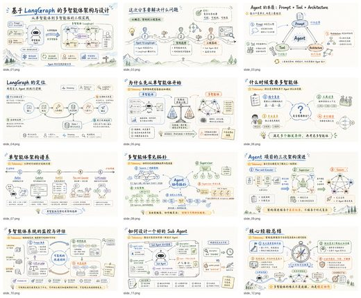</a> <a href="https://github.com/ningzimu/codex-ppt-skill">ningzimu/codex-ppt-skill</a></td>
<td align="center" valign="top"><a href="https://github.com/NyxTides/ppt-image-first">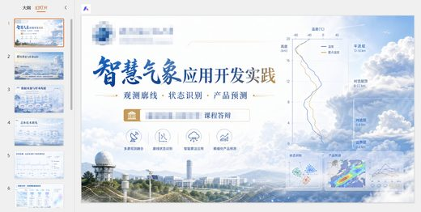</a> <a href="https://github.com/NyxTides/ppt-image-first">NyxTides/ppt-image-first</a></td>
<td align="center" valign="top"><a href="https://github.com/moongiadventures-dev/handdrawn-ppt">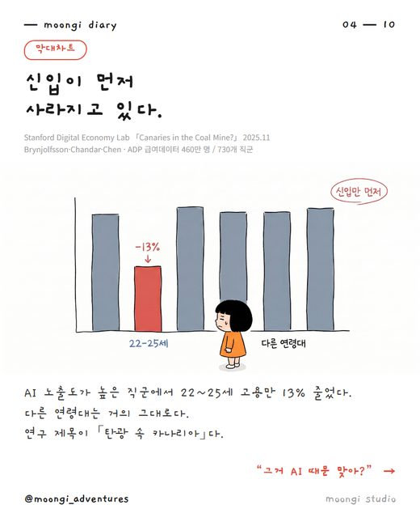</a> <a href="https://github.com/moongiadventures-dev/handdrawn-ppt">moongiadventures-dev/handdrawn-ppt</a></td>
</tr></table>

| 仓库 | 星数 | 做什么 | 安全评级 |
|---|---:|---|---|
| [ningzimu/codex-ppt-skill](https://github.com/ningzimu/codex-ppt-skill) | 7.9k | GPT-Image-2 图片型 PowerPoint 演示文稿生成 skill，适用于 Codex 等 agent | [SAFE](https://agentskillshub.top/skill/ningzimu/codex-ppt-skill/) |
| [NyxTides/ppt-image-first](https://github.com/NyxTides/ppt-image-first) | 1.2k | 面向 Codex/Claude Code/Opencode CLI 的图片优先 PPT skill | [SAFE](https://agentskillshub.top/skill/NyxTides/ppt-image-first/) |
| [stevenjinlong/awesome-ppt-skills](https://github.com/stevenjinlong/awesome-ppt-skills) | 75 | 将提示词转换为由 gpt-image-2 生成的整页式 PPT 演示文稿 | [SAFE](https://agentskillshub.top/skill/stevenjinlong/awesome-ppt-skills/) |
| [moongiadventures-dev/handdrawn-ppt](https://github.com/moongiadventures-dev/handdrawn-ppt) | 9 | 用一张角色图片制作手绘演示文稿的 Claude skill，支持资料调研、可靠来源、图表/表格/流程图，以及韩语和英语 | [SAFE](https://agentskillshub.top/skill/moongiadventures-dev/handdrawn-ppt/) |
| [Scott-Du/codex-ppt](https://github.com/Scott-Du/codex-ppt) | 7 | codex-ppt 是面向 Codex 的 PPT 制作 skill，用 image_gen 生成幻灯片图片并装配成 .pptx。 | [SAFE](https://agentskillshub.top/skill/Scott-Du/codex-ppt/) |
| [rocsgh/ppt-zen](https://github.com/rocsgh/ppt-zen) | 3 | 用于评判 AI 幻灯片的层，不是 PPT 生成器。 | [SAFE](https://agentskillshub.top/skill/rocsgh/ppt-zen/) |
| [uuoov/ppt-image-share-builder](https://github.com/uuoov/ppt-image-share-builder) | 1 | 以 Image2 为先的 Codex skill，用于生成 PPT 页面图、QA 拼图页、PPTX 封装和定时脚本。 | [SAFE](https://agentskillshub.top/skill/uuoov/ppt-image-share-builder/) |

## 🌐 网页幻灯片

[在在线页面打开这一类,按星数排序 →](https://agentskillshub.top/best/ppt-presentation/#type-html)

<table><tr>
<td align="center" valign="top"><a href="https://github.com/zarazhangrui/frontend-slides">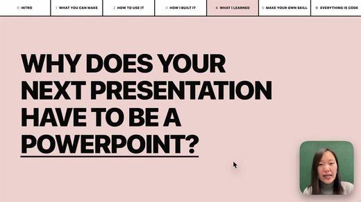</a> <a href="https://github.com/zarazhangrui/frontend-slides">zarazhangrui/frontend-slides</a></td>
<td align="center" valign="top"> <a href="https://github.com/archlizheng/frontend-slides-editable">archlizheng/frontend-slides-editable</a></td>
<td align="center" valign="top"><a href="https://github.com/daniel-style/magic-slide">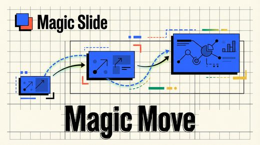</a> <a href="https://github.com/daniel-style/magic-slide">daniel-style/magic-slide</a></td>
</tr></table>

| 仓库 | 星数 | 做什么 | 安全评级 |
|---|---:|---|---|
| [zarazhangrui/frontend-slides](https://github.com/zarazhangrui/frontend-slides) | 32.3k | 使用 coding agent 的前端技能创建网页幻灯片 | [SAFE](https://agentskillshub.top/skill/zarazhangrui/frontend-slides/) |
| [op7418/guizang-ppt-skill](https://github.com/op7418/guizang-ppt-skill) | 29.8k | 用于生成 HTML 幻灯片的 AI-agent Skill：编辑杂志与瑞士风格布局、图像提示词、社交媒体封面及 WebGL/低功耗演示运行时 | [SAFE](https://agentskillshub.top/skill/op7418/guizang-ppt-skill/) |
| [chuspeeism/dashi-ppt-skill](https://github.com/chuspeeism/dashi-ppt-skill) | 10.7k | AI-agent skill，从多种视觉主题生成可在浏览器编辑的演示文稿，并导出为 HTML、PDF 和 PPTX。 | [SAFE](https://agentskillshub.top/skill/chuspeeism/dashi-ppt-skill/) |
| [lewislulu/html-ppt-skill](https://github.com/lewislulu/html-ppt-skill) | 9.1k | HTML PPT Studio——包含24种主题、31种布局和20多种动画的AgentSkill，用于制作HTML演示文稿 | [SAFE](https://agentskillshub.top/skill/lewislulu/html-ppt-skill/) |
| [archlizheng/frontend-slides-editable](https://github.com/archlizheng/frontend-slides-editable) | 555 | 适用于 Codex/Claude Code 的可编辑 HTML 演示文稿 skill，支持拖拽缩放、幻灯片排序、本地保存导出及 PPTX 转网页。致谢 @za… | [SAFE](https://agentskillshub.top/skill/archlizheng/frontend-slides-editable/) |
| [ryanbbrown/revealjs-skill](https://github.com/ryanbbrown/revealjs-skill) | 423 | 用于制作 reveal.js 演示文稿的 Claude Code skill | [SAFE](https://agentskillshub.top/skill/ryanbbrown/revealjs-skill/) |
| [robonuggets/marp-slides](https://github.com/robonuggets/marp-slides) | 335 | Claude Code 的 MARP 演示 skill：22 个示例、SVG 图表、明暗主题、仪表盘组件 | [SAFE](https://agentskillshub.top/skill/robonuggets/marp-slides/) |
| [borjaperfra/beatdeck](https://github.com/borjaperfra/beatdeck) | 243 | 演讲按节拍而非幻灯片：固定1920×1080 React舞台，一次点击一个节拍，支持离线、确定性、演讲者视图和Claude Code skill。 | [SAFE](https://agentskillshub.top/skill/borjaperfra/beatdeck/) |
| [mujingquan835/Dawang-ppt](https://github.com/mujingquan835/Dawang-ppt) | 190 | Dawang-PPT：内容驱动的中文演示 skill，支持场景规划、风格构图、浏览器编辑和 PPTX 导出（实验版） | [SAFE](https://agentskillshub.top/skill/mujingquan835/Dawang-ppt/) |
| [daniel-style/magic-slide](https://github.com/daniel-style/magic-slide) | 171 | 生成独立 HTML 演示文稿，支持流畅的 Magic Move 风格幻灯片过渡。 | [SAFE](https://agentskillshub.top/skill/daniel-style/magic-slide/) |
| [code-on-sunday/slide-deck-generator](https://github.com/code-on-sunday/slide-deck-generator) | 154 | 为 coding agents 提供的 AI skill，使用 React + Vite + Framer Motion 创建可用于生产的浏览器演示文稿幻灯片 | [SAFE](https://agentskillshub.top/skill/code-on-sunday/slide-deck-generator/) |
| [Kuneosu/make-slide](https://github.com/Kuneosu/make-slide) | 143 | 用于生成独立 HTML 幻灯片演示文稿的通用 AI skill | [SAFE](https://agentskillshub.top/skill/Kuneosu/make-slide/) |
| [joeseesun/qiaomu-bento-ppt](https://github.com/joeseesun/qiaomu-bento-ppt) | 126 | 使用独立的 qiaomu-bento-ppt skill，根据简报、笔记等创建或编辑 qiaomu 风格演示文稿，输出自包含的 .bento.html 文件 | [SAFE](https://agentskillshub.top/skill/joeseesun/qiaomu-bento-ppt/) |
| [gongnyang/awesome-html-scrolline-deck](https://github.com/gongnyang/awesome-html-scrolline-deck) | 111 | Scrolline Deck：Claude Code skill，滚动驱动 HTML 演示，含 12 种场景技法、进出编排和 10 个滚轮关卡。 | [SAFE](https://agentskillshub.top/skill/gongnyang/awesome-html-scrolline-deck/) |
| [UniUni2000/slideblocks-skill](https://github.com/UniUni2000/slideblocks-skill) | 89 | 用于创建和改进 Slidev 演示文稿的 SlideBlocks agent skill | [SAFE](https://agentskillshub.top/skill/UniUni2000/slideblocks-skill/) |
| [AIPMAndy/LivePPT](https://github.com/AIPMAndy/LivePPT) | 84 | Markdown 一键转可翻页、可分享的 HTML 演示页（Claude Code skill） | [SAFE](https://agentskillshub.top/skill/AIPMAndy/LivePPT/) |
| [pakco77/pakco-html](https://github.com/pakco77/pakco-html) | 77 | 60+种风格，演示与纵向页面，taste 图文，复制 Prompt | [SAFE](https://agentskillshub.top/skill/pakco77/pakco-html/) |
| [arifszn/slide-wright](https://github.com/arifszn/slide-wright) | 73 | 使用 AI agent skill 生成 reveal.js 幻灯片，每次提示采用新设计。 | [SAFE](https://agentskillshub.top/skill/arifszn/slide-wright/) |
| [cclank/lanshu-html-ppt-templates](https://github.com/cclank/lanshu-html-ppt-templates) | 62 | 20个独立HTML演示模板·226张幻灯片·Lanshu的可复用AI skill | [SAFE](https://agentskillshub.top/skill/cclank/lanshu-html-ppt-templates/) |
| [kaisersong/slide-creator](https://github.com/kaisersong/slide-creator) | 59 | 用于 AI 规划、风格探索并导出 PPTX 的 HTML 演示文稿生成 Claude Code skill | [SAFE](https://agentskillshub.top/skill/kaisersong/slide-creator/) |
| [glukicov/slideops](https://github.com/glukicov/slideops) | 54 | 将代码仓库转换为幻灯片，并提示何时与代码不一致 | [SAFE](https://agentskillshub.top/skill/glukicov/slideops/) |
| [whiteg2030-alt/BWC-XIXI-PPT-HTML](https://github.com/whiteg2030-alt/BWC-XIXI-PPT-HTML) | 49 | 细瘦风格PPT，HTML形式，内置白无常原创字体，可免费商用。调用此skill生成HTML和PPT两份，PPT文字可修改。 | [SAFE](https://agentskillshub.top/skill/whiteg2030-alt/BWC-XIXI-PPT-HTML/) |
| [FeeiCN/slide-writer](https://github.com/FeeiCN/slide-writer) | 45 | 用于根据想法、大纲、文档和演讲稿生成企业级 HTML 演示文稿的 slide-writing skill。 | [SAFE](https://agentskillshub.top/skill/FeeiCN/slide-writer/) |
| [SlideSpeak/slide-design-skill](https://github.com/SlideSpeak/slide-design-skill) | 41 | AI演示引擎：描述内容与风格，生成HTML幻灯片；Agent skill：npx skills add SlideSpeak/slide-design-ski… | [SAFE](https://agentskillshub.top/skill/SlideSpeak/slide-design-skill/) |
| [OrangeViolin/presentation-skill](https://github.com/OrangeViolin/presentation-skill) | 36 | 演讲脚本和PPT生成器，支持62种设计风格，基于 awesome-design-md，输入主题生成HTML幻灯片。 | [SAFE](https://agentskillshub.top/skill/OrangeViolin/presentation-skill/) |
| [keanu77/htmlpptskill](https://github.com/keanu77/htmlpptskill) | 36 | reveal.js Agent Skill：离线、QR、PPTX/PDF；Claude Code、Codex CLI、Gemini CLI、Grok Build | [SAFE](https://agentskillshub.top/skill/keanu77/htmlpptskill/) |
| [nghiahsgs/skills-slides](https://github.com/nghiahsgs/skills-slides) | 36 | 5万多个独特 HTML 演示设计。零依赖。拒绝 AI 垃圾风。Claude Code skill。 | [SAFE](https://agentskillshub.top/skill/nghiahsgs/skills-slides/) |
| [sharptoolbox/consulting-html-ppt](https://github.com/sharptoolbox/consulting-html-ppt) | 35 | 咨询风格 HTML + SVG 演示页生成 skill：McKinsey/BCG 风格、三形态判定、双模板库、ECharts | [SAFE](https://agentskillshub.top/skill/sharptoolbox/consulting-html-ppt/) |
| [dososo/blcaptain-ppt-skill](https://github.com/dososo/blcaptain-ppt-skill) | 33 | AI 原生单文件 HTML 演示 skill：7 套设计体系视觉风格，机器强制执行 WCAG、间距、32 维审计与反伪造规则，零依赖。 | [SAFE](https://agentskillshub.top/skill/dososo/blcaptain-ppt-skill/) |
| [dakjdakd/PPT-Design-DNA](https://github.com/dakjdakd/PPT-Design-DNA) | 30 | PPT-Design-DNA：将参考图转为可复用视觉系统，保存为 Design Profiles，并应用于 HTML 演示文稿的 skill。 | [SAFE](https://agentskillshub.top/skill/dakjdakd/PPT-Design-DNA/) |
| [alchaincyf/huashu-slide-codex](https://github.com/alchaincyf/huashu-slide-codex) | 25 | Codex 专用 AI 视觉素材制作 skill：幻灯片、微信封面及 Bilibili/YouTube 缩略图，使用内置 image_gen | [SAFE](https://agentskillshub.top/skill/alchaincyf/huashu-slide-codex/) |
| [jxshow/Jingge-PPT-skill](https://github.com/jxshow/Jingge-PPT-skill) | 25 | 鲸格PPT：17种视觉风格的可编辑HTML演示文稿、汇报、讲堂和发布模板。 | [SAFE](https://agentskillshub.top/skill/jxshow/Jingge-PPT-skill/) |
| [zhenwusw/orca-ppt-skill](https://github.com/zhenwusw/orca-ppt-skill) | 25 | orca-ppt-skill：供 AI Agent（Claude Code）生成页间连续运动的 HTML 演示稿，浏览器直接播放。 | [SAFE](https://agentskillshub.top/skill/zhenwusw/orca-ppt-skill/) |
| [lqshow/neon-slides](https://github.com/lqshow/neon-slides) | 20 | 将任意大纲转换为霓虹暗色 HTML 幻灯片的 Claude skill，用于技术直播和落地页。 | [SAFE](https://agentskillshub.top/skill/lqshow/neon-slides/) |
| [yevvonlim/kai-presentation](https://github.com/yevvonlim/kai-presentation) | 16 | Claude Code 的 KAI HTML 演示文稿设计 skill | [SAFE](https://agentskillshub.top/skill/yevvonlim/kai-presentation/) |
| [young920/gz-ppt-skill](https://github.com/young920/gz-ppt-skill) | 16 | 归藏 PPT Skill（研究学习用） | [SAFE](https://agentskillshub.top/skill/young920/gz-ppt-skill/) |
| [BigSweetPotatoStudio/ai-ppt-tutorial](https://github.com/BigSweetPotatoStudio/ai-ppt-tutorial) | 15 | Claude Code AI PPT 教程 | [SAFE](https://agentskillshub.top/skill/BigSweetPotatoStudio/ai-ppt-tutorial/) |
| [masaki39/marp-mcp](https://github.com/masaki39/marp-mcp) | 15 | 让 AI agents 通过结构化工具创建和编辑 Marp 幻灯片的 MCP server。 | [SAFE](https://agentskillshub.top/skill/masaki39/marp-mcp/) |
| [shawnzam/keynot](https://github.com/shawnzam/keynot) | 15 | Claude Code skill，将任意提示词转换为独立的 HTML 幻灯片，无需 Keynote 或 PowerPoint。 | [SAFE](https://agentskillshub.top/skill/shawnzam/keynot/) |
| [andyqiu847-ai/high-quality-slides](https://github.com/andyqiu847-ai/high-quality-slides) | 14 | Claude Code skill，采用研究优先、叙事驱动的5阶段流程制作演示文稿，灵感来自 Genspark AI Slides。 | [SAFE](https://agentskillshub.top/skill/andyqiu847-ai/high-quality-slides/) |
| [caikankan/cyberbin-ppt-skill](https://github.com/caikankan/cyberbin-ppt-skill) | 14 | 用于生成本地 HTML 幻灯片的 CyberBin PPT skill | [SAFE](https://agentskillshub.top/skill/caikankan/cyberbin-ppt-skill/) |
| [icytra/fudan-html-ppt-template](https://github.com/icytra/fudan-html-ppt-template) | 13 | 复旦大学 PPT 模板 skill | [SAFE](https://agentskillshub.top/skill/icytra/fudan-html-ppt-template/) |
| [lainshao/modern-ppt](https://github.com/lainshao/modern-ppt) | 13 | 单文件 HTML 演示文稿 Agent Skill：12 种布局、3 个主题、交互式图表和动画，支持 Claude Code、Codex CLI、Gemini… | [SAFE](https://agentskillshub.top/skill/lainshao/modern-ppt/) |
| [tjxj/dsh-wanghong-handwritten-ppt](https://github.com/tjxj/dsh-wanghong-handwritten-ppt) | 13 | 王虹学术手写风 PPT Skill for DeepSeek Harness，Notability 风格 HTML 幻灯片和 PNG 导出 | [SAFE](https://agentskillshub.top/skill/tjxj/dsh-wanghong-handwritten-ppt/) |
| [lanceli93/aws-html-slides](https://github.com/lanceli93/aws-html-slides) | 12 | 用于从零创建或将 PowerPoint 文件转换为动画丰富的 HTML 演示文稿的 agent skill | [SAFE](https://agentskillshub.top/skill/lanceli93/aws-html-slides/) |
| [Watermelon4000/sketch-note-ppt](https://github.com/Watermelon4000/sketch-note-ppt) | 11 | 将“制作关于 X 的 PPT”转为 Sketch Notes 风格演示文稿的 AI skill：单个自包含 HTML 文件，无需构建。 | [SAFE](https://agentskillshub.top/skill/Watermelon4000/sketch-note-ppt/) |
| [alingowangxr/guizang-ppt-skill](https://github.com/alingowangxr/guizang-ppt-skill) | 11 | 归藏 PPT Skill：网页 PPT、配图、常用社交平台封面生成（支持简繁中文） | [SAFE](https://agentskillshub.top/skill/alingowangxr/guizang-ppt-skill/) |
| [cogine-ai/ai-slide-templates](https://github.com/cogine-ai/ai-slide-templates) | 11 | 带有元数据和 AGENTS.md 指令的自包含 HTML 幻灯片模板，供 AI agent 创建完整演示文稿。 | [SAFE](https://agentskillshub.top/skill/cogine-ai/ai-slide-templates/) |
| [Chris-yoo80/ppt-to-html-agent](https://github.com/Chris-yoo80/ppt-to-html-agent) | 10 | 可暂停的动画，可讲解的故事。提供源码的 PPT 转 HTML agent skill，含双语交互演示。 | [SAFE](https://agentskillshub.top/skill/Chris-yoo80/ppt-to-html-agent/) |
| [RDDcat/maro-ppt](https://github.com/RDDcat/maro-ppt) | 10 | PPT 制作 skill——通过访谈整理为说服结构的单 HTML 演示文稿（Claude Code skill） | [SAFE](https://agentskillshub.top/skill/RDDcat/maro-ppt/) |
| [alfredo-hs/quarto-talks](https://github.com/alfredo-hs/quarto-talks) | 10 | 使用 Quarto 制作 RevealJS 幻灯片的 agent skill | [SAFE](https://agentskillshub.top/skill/alfredo-hs/quarto-talks/) |
| [thmsgo18/presentation-forge](https://github.com/thmsgo18/presentation-forge) | 10 | 可移植的 Claude skill，用于制作自包含 HTML 演示文稿：编写幻灯片并导入品牌主题（PowerPoint、图片或描述）。 | [SAFE](https://agentskillshub.top/skill/thmsgo18/presentation-forge/) |
| [w1ndys/html-ppt-academic-skill](https://github.com/w1ndys/html-ppt-academic-skill) | 10 | 面向高校师生的 HTML PPT Skill，生成学术汇报风格的静态 HTML 幻灯片。 | [SAFE](https://agentskillshub.top/skill/w1ndys/html-ppt-academic-skill/) |
| [embabel/decker](https://github.com/embabel/decker) | 9 | 创建幻灯片演示文稿的智能体 | [SAFE](https://agentskillshub.top/skill/embabel/decker/) |
| [theolundqvist/justshowme](https://github.com/theolundqvist/justshowme) | 9 | 让 AI agent 用交互式图表和幻灯片回答，并附加到 PR，而不是 Markdown | [SAFE](https://agentskillshub.top/skill/theolundqvist/justshowme/) |
| [bjoern2000/deckpipe](https://github.com/bjoern2000/deckpipe) | 8 | 面向 agent 的幻灯片渲染引擎。用 HTML/CSS/JS 制作幻灯片，获取可分享的查看器 URL。 | [SAFE](https://agentskillshub.top/skill/bjoern2000/deckpipe/) |
| [chenyangji666/html-ppt-skill](https://github.com/chenyangji666/html-ppt-skill) | 8 | 纯 HTML/CSS/JS 演示文稿引擎和 AI 生成协议 | [SAFE](https://agentskillshub.top/skill/chenyangji666/html-ppt-skill/) |
| [karem505/karem-arabic-presentation](https://github.com/karem505/karem-arabic-presentation) | 8 | 用于生成支持 RTL、动画和专业深色主题的阿拉伯语/英语双语 HTML 演示文稿的 Claude Code skill | [SAFE](https://agentskillshub.top/skill/karem505/karem-arabic-presentation/) |
| [AgentiaPT/vela-slides](https://github.com/AgentiaPT/vela-slides) | 7 | Vela Slides - AI 演示文稿应用和 Agent Skill | [SAFE](https://agentskillshub.top/skill/AgentiaPT/vela-slides/) |
| [severli93/moonland-deck](https://github.com/severli93/moonland-deck) | 7 | Dopamine-Swiss HTML 演示文稿设计系统——Claude skill | [SAFE](https://agentskillshub.top/skill/severli93/moonland-deck/) |
| [tomacco/deckadence](https://github.com/tomacco/deckadence) | 7 | HTML 演示文稿的 Claude Code skill。单文件、无框架，以摄像机观察一个世界。 | [SAFE](https://agentskillshub.top/skill/tomacco/deckadence/) |
| [VangelisHaha/deck-stage](https://github.com/VangelisHaha/deck-stage) | 6 | Agent 写演示稿，macOS HTML 演示放映壳，支持双屏、演讲者视图、手机遥控和投屏 | [SAFE](https://agentskillshub.top/skill/VangelisHaha/deck-stage/) |
| [alohays/paper2pr](https://github.com/alohays/paper2pr) | 6 | AI/ML 论文 → 通过 Claude Code 多 agent 工作流生成演示用 Beamer + Quarto 幻灯片 | [SAFE](https://agentskillshub.top/skill/alohays/paper2pr/) |
| [ancarmona/keystone](https://github.com/ancarmona/keystone) | 6 | 用于技术演讲的本地 HTML 幻灯片工具：演示、编辑、样式库、与 Claude Code 反馈、发布 | [SAFE](https://agentskillshub.top/skill/ancarmona/keystone/) |
| [Codagent-AI/and-scene](https://github.com/Codagent-AI/and-scene) | 5 | 用于构建动态变形幻灯片演示的 Agent Skill | [SAFE](https://agentskillshub.top/skill/Codagent-AI/and-scene/) |
| [calumhrmurray/lectern](https://github.com/calumhrmurray/lectern) | 5 | AI生成演示文稿的可视化拖放编辑器。让Claude、ChatGPT或编程agent创建演示文稿，再自行调整布局；reveal.js HTML文件即文档。离线、… | [SAFE](https://agentskillshub.top/skill/calumhrmurray/lectern/) |
| [chengzi2333/html-report-skill](https://github.com/chengzi2333/html-report-skill) | 5 | Agent Skill for turning Markdown and PowerPoint into polished, interactive, browser-ready HTML reports.将 Markdown 与 PPT 转为精美、可交互、浏览器即开的 HTML 汇报的 Agen… | [SAFE](https://agentskillshub.top/skill/chengzi2333/html-report-skill/) |
| [cskwork/pptx-to-html-updated](https://github.com/cskwork/pptx-to-html-updated) | 5 | 将 PowerPoint .pptx 转为忠实 HTML 包：实时 Chart.js 图表、SVG 图形、嵌入字体和动画。Python agent skill。 | [SAFE](https://agentskillshub.top/skill/cskwork/pptx-to-html-updated/) |
| [grunion-ai/decklet](https://github.com/grunion-ai/decklet) | 5 | Claude Code、Codex 的 skill/CLI：将内容生成单文件、零依赖的可编辑 HTML 幻灯片，含115个模板、图表、图示、编辑器和矢量PDF。 | [SAFE](https://agentskillshub.top/skill/grunion-ai/decklet/) |
| [joelbarmettlerUZH/slidev-mcp](https://github.com/joelbarmettlerUZH/slidev-mcp) | 5 | 用于生成、渲染和托管 Slidev 演示文稿的 MCP 服务器 | [SAFE](https://agentskillshub.top/skill/joelbarmettlerUZH/slidev-mcp/) |
| [sharptoolbox/code-walkthrough-ppt-video](https://github.com/sharptoolbox/code-walkthrough-ppt-video) | 5 | 从源代码生成产品讲解 HTML PPT 或中文视频的 Agent Skill | [SAFE](https://agentskillshub.top/skill/sharptoolbox/code-walkthrough-ppt-video/) |
| [tanglele110-hash/zhongguose-ppt-skill](https://github.com/tanglele110-hash/zhongguose-ppt-skill) | 5 | 中国色汇报演示 Agent Skill | [SAFE](https://agentskillshub.top/skill/tanglele110-hash/zhongguose-ppt-skill/) |
| [tokuhn/confidential-html-deck](https://github.com/tokuhn/confidential-html-deck) | 5 | 从机密数据生成 16:9 幻灯片的 Claude skill，Claude 无法看到数据。真实值在浏览器本地输入且不会离开浏览器。支持导出 PDF。 | [UNSAFE](https://agentskillshub.top/skill/tokuhn/confidential-html-deck/) |

## 💼 商务与咨询风

[在在线页面打开这一类,按星数排序 →](https://agentskillshub.top/best/ppt-presentation/#type-business)

<table><tr>
<td align="center" valign="top"> <a href="https://github.com/Pikapika260214/rw-consulting-ppt">Pikapika260214/rw-consulting-ppt</a></td>
<td align="center" valign="top"><a href="https://github.com/likaku/Mck-ppt-design-skill">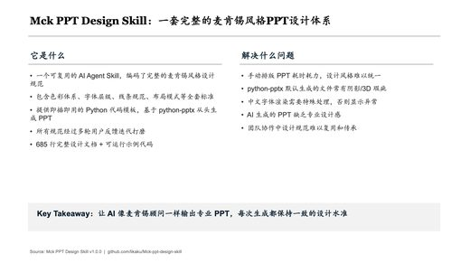</a> <a href="https://github.com/likaku/Mck-ppt-design-skill">likaku/Mck-ppt-design-skill</a></td>
<td align="center" valign="top"><a href="https://github.com/Ronnie2025/codex-ppt-skill">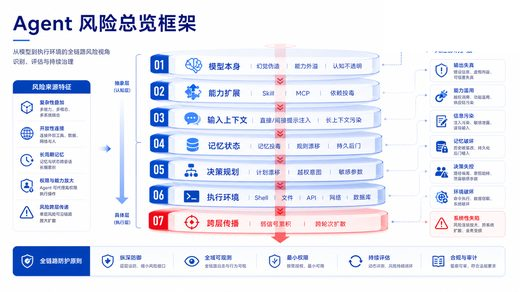</a> <a href="https://github.com/Ronnie2025/codex-ppt-skill">Ronnie2025/codex-ppt-skill</a></td>
</tr></table>

| 仓库 | 星数 | 做什么 | 安全评级 |
|---|---:|---|---|
| [carnot-tech/jinba-consulting-pptx-skill](https://github.com/carnot-tech/jinba-consulting-pptx-skill) | 1.6k | 让 AI 制作正经 PPTX 的 Claude Code / Codex skill | [SAFE](https://agentskillshub.top/skill/carnot-tech/jinba-consulting-pptx-skill/) |
| [Pikapika260214/rw-consulting-ppt](https://github.com/Pikapika260214/rw-consulting-ppt) | 558 | 带可编辑选项的咨询演示文稿 skill，适用于 Codex | [SAFE](https://agentskillshub.top/skill/Pikapika260214/rw-consulting-ppt/) |
| [likaku/Mck-ppt-design-skill](https://github.com/likaku/Mck-ppt-design-skill) | 340 | 面向 AI agent 的咨询公司风格 PowerPoint 设计系统，含 70 种布局模式，扁平设计，基于 python-pptx。 | [SAFE](https://agentskillshub.top/skill/likaku/Mck-ppt-design-skill/) |
| [Ronnie2025/codex-ppt-skill](https://github.com/Ronnie2025/codex-ppt-skill) | 223 | 中文 toB 商业汇报的 Codex PPT 生图、元素重组与 SVG 拆解工作流 | [SAFE](https://agentskillshub.top/skill/Ronnie2025/codex-ppt-skill/) |
| [kgraph57/mckinsey-style-visualization-skill](https://github.com/kgraph57/mckinsey-style-visualization-skill) | 175 | 将杂乱笔记转为战略咨询视觉图，提供 SVG 示例和验证的 skill | [SAFE](https://agentskillshub.top/skill/kgraph57/mckinsey-style-visualization-skill/) |
| [SenseTime-Copilot/raccoon-ppt-skill](https://github.com/SenseTime-Copilot/raccoon-ppt-skill) | 148 | 为 OpenClaw 提供远程 PPT 生成 skill，支持创建、续接任务、轮询和下载。 | [SAFE](https://agentskillshub.top/skill/SenseTime-Copilot/raccoon-ppt-skill/) |
| [kimsh-1/deck-factory](https://github.com/kimsh-1/deck-factory) | 83 | 一行意图 → 一份演示级深色编辑风 HTML 演示文稿。Claude Code skill。 | [SAFE](https://agentskillshub.top/skill/kimsh-1/deck-factory/) |
| [abxxvrv/spacex-ppt-skill](https://github.com/abxxvrv/spacex-ppt-skill) | 33 | 用于生成 SpaceX 路演风格演示文稿的 AI skill，支持导出 PDF 和 PNG。 | [SAFE](https://agentskillshub.top/skill/abxxvrv/spacex-ppt-skill/) |
| [FW1201/visual-presentation-production](https://github.com/FW1201/visual-presentation-production) | 32 | 适用于 Codex 和 ChatGPT Work 的便携式 16:9 图片演示制作 skill | [SAFE](https://agentskillshub.top/skill/FW1201/visual-presentation-production/) |
| [shenxiaofeng-pro/jiarui-svg-skills](https://github.com/shenxiaofeng-pro/jiarui-svg-skills) | 31 | 伽睿风格PPT图片制作技能包：生成含公司Logo、主色和清晰结构的SVG图片，可取消组合后编辑为PPT图片 | [SAFE](https://agentskillshub.top/skill/shenxiaofeng-pro/jiarui-svg-skills/) |
| [floflo11/mbb-decks](https://github.com/floflo11/mbb-decks) | 22 | 适用于 Claude 的 MBB 风格咨询演示文稿 skill：行动标题式叙事、MECE 要点、公司徽标作项目符号、输出真实 .pptx 文件。 | [SAFE](https://agentskillshub.top/skill/floflo11/mbb-decks/) |
| [NomiciAI/mbb-page-maker](https://github.com/NomiciAI/mbb-page-maker) | 10 | 使用静态 HTML/CSS/JS 创建咨询风格演示文稿的 AgentSkill。 | [SAFE](https://agentskillshub.top/skill/NomiciAI/mbb-page-maker/) |
| [GZPengyuyan/PengyuyanPPT](https://github.com/GZPengyuyan/PengyuyanPPT) | 9 | 生成高密度、可编辑、咨询风格 PowerPoint 的 Codex Skill，支持 SCR 叙事、风格确认和 PPTX 质量检查 | [SAFE](https://agentskillshub.top/skill/GZPengyuyan/PengyuyanPPT/) |
| [marcusnelson/presentation-writing-claude-skill](https://github.com/marcusnelson/presentation-writing-claude-skill) | 6 | 用于撰写有说服力演示文稿的 Claude skill，将笔记、文档和数据转为逐页叙事大纲，适用于路演、董事会演示、主题演讲和销售会议，注重论证结构和故事叙述，… | [SAFE](https://agentskillshub.top/skill/marcusnelson/presentation-writing-claude-skill/) |
| [hunkim/slide-skill](https://github.com/hunkim/slide-skill) | 5 | 让 Claude/Codex 制作易读幻灯片的 agent skill：每页一个要点、Death by PowerPoint 原则、发布前检查清单。无需密钥和… | [SAFE](https://agentskillshub.top/skill/hunkim/slide-skill/) |
| [knorq-ai/pptx-mcp-server](https://github.com/knorq-ai/pptx-mcp-server) | 5 | 生成 PowerPoint 演示文稿的 MCP 服务器，支持 McKinsey、Deloitte、Neutral 主题 | [SAFE](https://agentskillshub.top/skill/knorq-ai/pptx-mcp-server/) |
| [xxxd666/special-achievement-report](https://github.com/xxxd666/special-achievement-report) | 5 | 让任何人都能做出咨询公司级的成果汇报 · 9 大方法论 · 一个 Claude 技能 Empower anyone to deliver consulting-grade presentation results · 9 methodologies · One Claude skill | [SAFE](https://agentskillshub.top/skill/xxxd666/special-achievement-report/) |

## 📄 文档转 PPT

[在在线页面打开这一类,按星数排序 →](https://agentskillshub.top/best/ppt-presentation/#type-convert)

<table><tr>
<td align="center" valign="top"> <a href="https://github.com/hugohe3/ppt-master">hugohe3/ppt-master</a></td>
<td align="center" valign="top"><a href="https://github.com/crazyykhllc-bit/CyberPPT">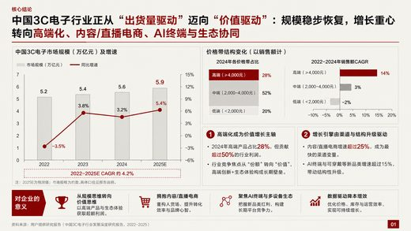</a> <a href="https://github.com/crazyykhllc-bit/CyberPPT">crazyykhllc-bit/CyberPPT</a></td>
<td align="center" valign="top"><a href="https://github.com/Faust-Donf/beamer-academic">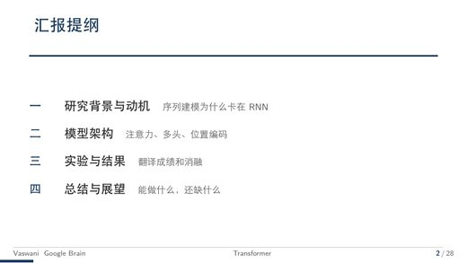</a> <a href="https://github.com/Faust-Donf/beamer-academic">Faust-Donf/beamer-academic</a></td>
</tr></table>

| 仓库 | 星数 | 做什么 | 安全评级 |
|---|---:|---|---|
| [hugohe3/ppt-master](https://github.com/hugohe3/ppt-master) | 76.8k | AI 将文档或主题生成 PowerPoint 演示文稿，支持原生形状、转场、动画、按需数据图表与表格、备注转音频旁白及自定义 .pptx 模板。Hugo He | [SAFE](https://agentskillshub.top/skill/hugohe3/ppt-master/) |
| [op7418/NanoBanana-PPT-Skills](https://github.com/op7418/NanoBanana-PPT-Skills) | 3.4k | NanoBanana PPT Skills：用 AI 生成 PPT 图片和视频，支持转场和交互式播放 | [CAUTION](https://agentskillshub.top/skill/op7418/NanoBanana-PPT-Skills/) |
| [crazyykhllc-bit/CyberPPT](https://github.com/crazyykhllc-bit/CyberPPT) | 1.9k | 生成高密度、可编辑咨询风格 PowerPoint 的 Codex Skill，支持 SCR 叙事、风格确认和 PPTX 质量检查。 | [SAFE](https://agentskillshub.top/skill/crazyykhllc-bit/CyberPPT/) |
| [Gabberflast/academic-pptx-skill](https://github.com/Gabberflast/academic-pptx-skill) | 1.5k | Claude skill：学术演示文稿制作，规范行动标题、论证、图表和引用，强调沟通优先；支持 Anthropic 内置 PPTX skill。 | [SAFE](https://agentskillshub.top/skill/Gabberflast/academic-pptx-skill/) |
| [irenerachel/visual-style-ppt-skill](https://github.com/irenerachel/visual-style-ppt-skill) | 398 | 【Skill】视觉风格 PPT 生成工作流 | [SAFE](https://agentskillshub.top/skill/irenerachel/visual-style-ppt-skill/) |
| [Noi1r/beamer-skill](https://github.com/Noi1r/beamer-skill) | 374 | 用于创建、编译、审阅和完善学术 Beamer LaTeX 演示文稿的 Claude Code skill，涵盖质量评分、教学审阅和 TikZ 检查等流程。 | [SAFE](https://agentskillshub.top/skill/Noi1r/beamer-skill/) |
| [Faust-Donf/beamer-academic](https://github.com/Faust-Donf/beamer-academic) | 337 | 根据论文生成学术答辩PPT，Claude Code & Codex Skill | [SAFE](https://agentskillshub.top/skill/Faust-Donf/beamer-academic/) |
| [M1n-n9/academic-ppt-master](https://github.com/M1n-n9/academic-ppt-master) | 309 | 将论文转换为可编辑的学术 PPTX 演示文稿 | [SAFE](https://agentskillshub.top/skill/M1n-n9/academic-ppt-master/) |
| [vigorX777/ppt-svg-generator](https://github.com/vigorX777/ppt-svg-generator) | 262 | ppt-svg-generator 是一个 skill，可将 Markdown 转为 PPT 或 PDF，支持预设风格。 | [SAFE](https://agentskillshub.top/skill/vigorX777/ppt-svg-generator/) |
| [helloo1568/slidemuse](https://github.com/helloo1568/slidemuse) | 216 | 视觉优先的 AI PPT skill，支持4套风格，生成可编辑 PPTX，适用于竞赛、汇报、答辩、路演和课程展示 | [SAFE](https://agentskillshub.top/skill/helloo1568/slidemuse/) |
| [fangyuanopus/literature-report-ppt-builder](https://github.com/fangyuanopus/literature-report-ppt-builder) | 122 | 用于生成学术文献报告 PPT 的开源 Codex skill | [SAFE](https://agentskillshub.top/skill/fangyuanopus/literature-report-ppt-builder/) |
| [deathcats4/scholar-ppt-cn](https://github.com/deathcats4/scholar-ppt-cn) | 60 | Codex / ChatGPT 的 AI 学术 PPT 工作流 skill：将论文转为可编辑 PowerPoint，生成规划表、mockup 系列和 PPTX | [SAFE](https://agentskillshub.top/skill/deathcats4/scholar-ppt-cn/) |
| [joeseesun/qiaomu-ppt](https://github.com/joeseesun/qiaomu-ppt) | 37 | 中文优先的演示文稿工作流：将 URL/PDF/NotebookLM/HTML Deck 转为可编辑、可验证的 PPT | [SAFE](https://agentskillshub.top/skill/joeseesun/qiaomu-ppt/) |
| [hanlulong/econ-slides-skill](https://github.com/hanlulong/econ-slides-skill) | 30 | 将经济学论文转为 Beamer 演示文稿，配定时讲稿，含会议、求职市场和讨论人幻灯片。适用于 Claude Code 和 Codex 的 Agent Skil… | [SAFE](https://agentskillshub.top/skill/hanlulong/econ-slides-skill/) |
| [icgma/slide-skill](https://github.com/icgma/slide-skill) | 16 | 以 SVG 为先的幻灯片生成工具包，支持智能内容规划和领域专用布局 | [SAFE](https://agentskillshub.top/skill/icgma/slide-skill/) |
| [DAIBird-0/pdf2ppt_skill](https://github.com/DAIBird-0/pdf2ppt_skill) | 12 | pdf2ppt_skill：将论文 PDF 制作为可编辑组会 PPT 的 Codex Skill，先确认方案，再输出 PPT、讲稿和预览。 | [SAFE](https://agentskillshub.top/skill/DAIBird-0/pdf2ppt_skill/) |
| [SHALINS428/Academic-PPT-Skill](https://github.com/SHALINS428/Academic-PPT-Skill) | 12 | 开源 skill：将论文材料整理为严谨、可编辑的学术答辩 PPT，支持规划、验证和基于来源生成幻灯片。 | [SAFE](https://agentskillshub.top/skill/SHALINS428/Academic-PPT-Skill/) |
| [moyoo0/paper-to-latex-ppt](https://github.com/moyoo0/paper-to-latex-ppt) | 12 | 输入论文，输出适合组会汇报并附讲稿的PPT。 | [CAUTION](https://agentskillshub.top/skill/moyoo0/paper-to-latex-ppt/) |
| [doudou1337/deckset-claude-skill](https://github.com/doudou1337/deckset-claude-skill) | 11 | 用于用 Markdown 创建 Deckset 演示文稿的 Claude Code skill，含 29 个文档、3 个示例演示文稿和自动抓取器。 | [SAFE](https://agentskillshub.top/skill/doudou1337/deckset-claude-skill/) |
| [smallSheep123/paper-skills](https://github.com/smallSheep123/paper-skills) | 11 | 学术组会汇报 PPT 的 agent skills | [SAFE](https://agentskillshub.top/skill/smallSheep123/paper-skills/) |
| [wp-a/paper2ppt](https://github.com/wp-a/paper2ppt) | 11 | 将学术论文转换为可编辑、可追溯的中文 PPTX，兼容 Codex 和 Claude Code。 | [SAFE](https://agentskillshub.top/skill/wp-a/paper2ppt/) |
| [SkillMelody/PPT-Smith](https://github.com/SkillMelody/PPT-Smith) | 9 | MeowClaw PPT Smith — 与模型无关的演示文稿编译器 skill | [SAFE](https://agentskillshub.top/skill/SkillMelody/PPT-Smith/) |
| [wendaokeliu-sys/ppt-builder](https://github.com/wendaokeliu-sys/ppt-builder) | 9 | 用 DeepSeek 将方案、报告、手册生成可编辑 PPT 的 skill | [SAFE](https://agentskillshub.top/skill/wendaokeliu-sys/ppt-builder/) |
| [zl190/md-slides](https://github.com/zl190/md-slides) | 9 | 用于将 MD 转为 Slides 的 Claude Code skill | [CAUTION](https://agentskillshub.top/skill/zl190/md-slides/) |
| [FA-T-T/codex-skill-academic-slides](https://github.com/FA-T-T/codex-skill-academic-slides) | 8 | 使用 GPT Image 2 制作学术幻灯片、海报、校样和架构图的 Codex skill | [SAFE](https://agentskillshub.top/skill/FA-T-T/codex-skill-academic-slides/) |
| [ficooooo/Paper2ScholarSlides](https://github.com/ficooooo/Paper2ScholarSlides) | 8 | 面向学术综述的PPT生成skill，将初稿、论文资料和模板转为结构严谨、引用清晰、图表公式可解释并经导出校验的汇报稿。 | [SAFE](https://agentskillshub.top/skill/ficooooo/Paper2ScholarSlides/) |
| [codezzzsleep/research-ppt-skill](https://github.com/codezzzsleep/research-ppt-skill) | 7 | 研究组风格中文学术汇报PPT Skill（Agent Skill）：论文精读、文献/组会汇报与综述，生成.pptx，含排版库和渲染检查 | [SAFE](https://agentskillshub.top/skill/codezzzsleep/research-ppt-skill/) |
| [MaximeRumpler/Make_PPTX](https://github.com/MaximeRumpler/Make_PPTX) | 6 | Make PPTX：笔记转PowerPoint；Make Clean PPTX版式、Make Style PPTX外观、Make Colors PPTX配色，… | [SAFE](https://agentskillshub.top/skill/MaximeRumpler/Make_PPTX/) |
| [demoolight/academic-image-ppt](https://github.com/demoolight/academic-image-ppt) | 6 | 用于生成学术图片型 PPT 的 Codex skill | [SAFE](https://agentskillshub.top/skill/demoolight/academic-image-ppt/) |
| [sujunmin/agy-ppt](https://github.com/sujunmin/agy-ppt) | 6 | Turn reports into PowerPoint decks without the AI-slop look. An agent skill purpose-built for the Antigravity + Kiro + Codex pipeline — GPT-image ren… | [SAFE](https://agentskillshub.top/skill/sujunmin/agy-ppt/) |
| [2654400439/Paper2Seminar](https://github.com/2654400439/Paper2Seminar) | 5 | 将研究论文转为完整、可编辑、适合研讨会的 PPTX 演示文稿的 Agent Skill | [SAFE](https://agentskillshub.top/skill/2654400439/Paper2Seminar/) |
| [MURMURE11118586/codex-xkppt-skill](https://github.com/MURMURE11118586/codex-xkppt-skill) | 5 | 面向 Codex 的 PPT 制作 skill，支持从主题、文档、PDF、Markdown 或 PPT 生成演示文稿，并提供模板、导出和 QA 检查。 | [SAFE](https://agentskillshub.top/skill/MURMURE11118586/codex-xkppt-skill/) |
| [Skywalkerjieee/paper-sharing-ppt](https://github.com/Skywalkerjieee/paper-sharing-ppt) | 5 | 用于制作组会论文分享 PPT 的 skill | [SAFE](https://agentskillshub.top/skill/Skywalkerjieee/paper-sharing-ppt/) |

**安全评级**是 Agent Skills Hub 对仓库 README 和安装步骤的评级。*待评级*表示目录还没评到它。

预览图是各项目 README 里图片的缩小副本,只收录采用宽松许可证的项目,版权归原作者所有。来源和许可证见 [assets/previews/NOTICE.md](assets/previews/NOTICE.md)。如需移除请提 issue。

## 相关合集

- [zhuyansen/awesome-claude-video-skills](https://github.com/zhuyansen/awesome-claude-video-skills) —— 同样做法的视频 skill 合集。

## 推荐仓库

提一个 issue 附上 GitHub 链接。它会走和每个条目一样的评审;决定上不上榜的是上面的规则,不是星数。

---

机器可读版本:[`data/skills.json`](data/skills.json)。生成于 2026-11-14。
